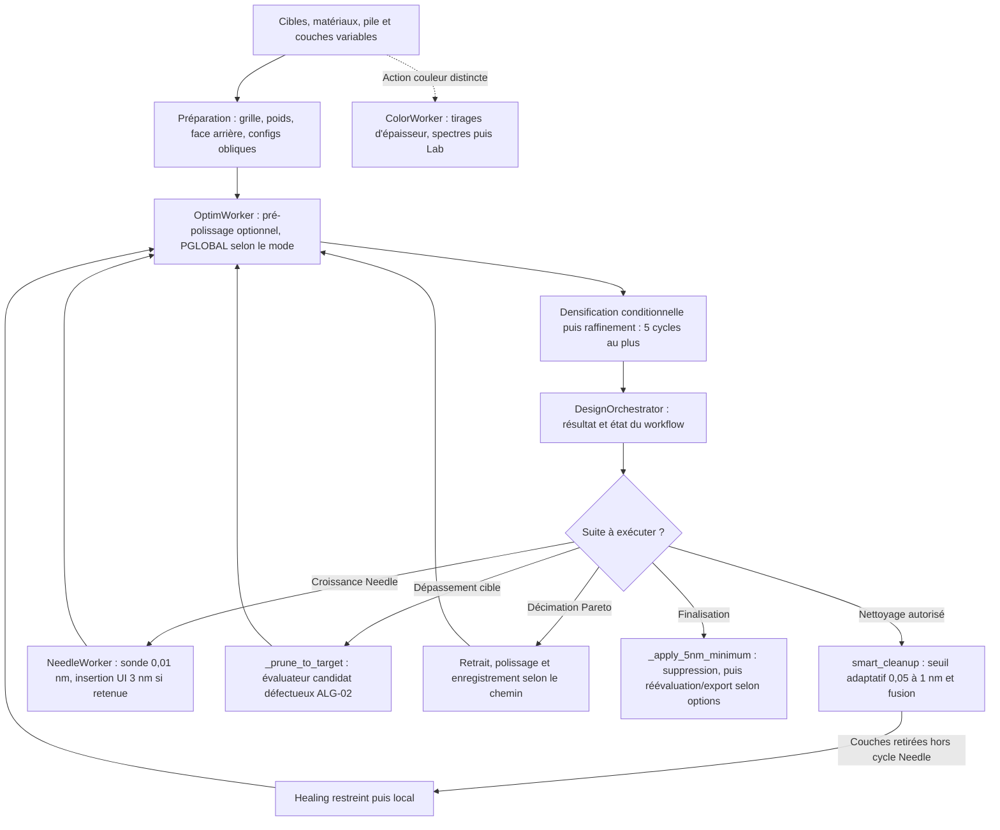

# Audit Algorithmique Complet & Pistes d'Amélioration — CERTUS_DESIGN (`designargon.md`)

> **Date de l'audit** : 16 octobre 2026
> **Périmètre** : `CERTUS_DESIGN` ([CERTUS_DESIGN.py](CERTUS_DESIGN.py)) et l'ensemble de sa chaîne algorithmique de calcul électromagnétique, de dérivation analytique, d'optimisation globale/locale, de synthèse topologique Needle, d'élagage (*Overshoot & Prune*, *Smart Cleanup*), de décimation de Pareto et de robustesse Monte-Carlo.
> **Objectif** : Identifier les défauts et les pistes d'amélioration ; la couverture de cet audit ne prouve pas l'absence d'autres défauts.
> **Contre-audit Codex, 2026-10-16** : code de production inchangé à `0c7c1e2e` ; [20 observations ciblées et 22 démarrages GUI communs aux deux audits](reports/ARGON_contre_audit_2026-10-16/evidence.json), [script reproductible](reports/ARGON_contre_audit_2026-10-16/probe.py.txt). Aucun correctif algorithmique ni gain de performance mesuré. Préflight `STOP` (lancement Ruff défaillant et 60 fichiers suivis déjà modifiés) ; périmètre documentaire demandé par 👤.

> **Recoupement avec le code, 2026-10-20** (`4c10ce44`) : ALG-01 à ALG-11 tiennent ; D08/U01 corrigés (`bdcae9ed`) ; amendements marqués `[CORRIGÉ]`/`[AMENDÉ]` ; [bilan](reports/AUDIT_UX_recoupement_2026-10-20.md).

**Statut des propositions.** ALG-01 et ALG-02 sont reproduits sur fonctions extraites ; ALG-03 est étayé par le contrat du helper et une densification contrôlée, sans parcours complet du worker. ALG-04 à ALG-11 mélangent limites fonctionnelles, choix de conception et expériences. Les accélérations et améliorations de qualité sans campagne jointe sont des hypothèses. Les diagnostics de solveur « maison », d'absence de `jac` dans l'élagage et la formule initiale du rayon PGLOBAL étaient faux. Ordre et critères de fin en §9 ; intégrité de la pile et interface dans [UXargon.md](UXargon.md).

**Portée des preuves.** Les sondes exécutent les corps de fonctions extraits à l'AST avec dépendances contrôlées ; les décorateurs Numba sont retirés. Elles ne valident ni compilation JIT, parallélisme, workflow complet, exécutable gelé ni performances. Leurs limites et les empreintes des sources figurent dans le JSON. « Observation vérifiée » inclut les défauts reproduits ; cela ne signifie pas « logiciel corrigé ».

| Sonde | Conclusion étayée | Ce qui reste à établir |
|---|---|---|
| D01 | Trois cas, dont absorbant et poids non uniformes : coût scan/référence = `sum(w)/count`. Multiplier les poids par 7 multiplie le scan par 7, sans changer la référence. | JIT et décision réelle de raffinement/gain ; corpus d'incidences et masques. |
| D02 | `Target.val` absent : exception absorbée, retour `inf`. Types du tuple de préparation incompatibles avec le dépaquetage. `jac=True` est déjà présent dans ce même évaluateur. | Reproduire la sélection complète et conserver couches fixes/bornes après réparation. |
| D03 | Helper densifié de 2 à 90 points ; nouveaux configs construits mais absents des 6 valeurs retournées. | Observer la grille réellement utilisée par le coût et le gradient du worker. |
| D04 | Les six permutations d'un dictionnaire H/L/M changent les matériaux retenus par le masque actif. | Ensemble autorisé et choix du candidat sur un scan complet. |
| D05 | Vrai `LBFGSBSearcher` + SciPy : minimum borné atteint à x=1 sur une quadratique dont le minimum libre est 2. | Repli d'API privée, autres bornes et budgets ; aucun débit mesuré. |
| D06 | Coût scalaire inchangé pour `min_d=0/5`. Wrapper analytique avant seul : coût pénalisé mais gradient nul avec noyau optique constant contrôlé ; différence finie ≈ −9,8×10⁶. | Vérification avec vrais noyaux, face arrière et contraintes du worker. |
| D07 | Rayon critique conforme à §4.1 sur trois cas ; résolveur non gelé : 8 CPU contrôlés → 6 workers. | Performances et arrêt bayésien en campagne ; aucune preuve d'optimum global. |
| D08 | **[CORRIGÉ `bdcae9ed`]** Filtre final réel : une couche fixe de 2 nm est supprimée, la couche de 5 nm conservée ; ancien mérite invalidé. | Workflow complet, couche supprimée optiquement utile, conséquences sur le cahier des charges. |
| M01 | Dérivée matricielle corrigée, différence de T ≈ 0,061 malgré même épaisseur optique, minimum interdit à 2,5 nm sous pénalité gap ; moyenne s/p différente de deux cibles. | Cas dispersifs, obliques et absorption ; validation des capacités proposées. |

---

## 1. Synthèse Exécutive & Cartographie de l'Architecture Algorithmique

### 1.1 Architecture actuelle du pipeline d'optimisation et de synthèse

Le moteur algorithmique de `CERTUS_DESIGN` est réparti sur quatre couches principales :

1. **Noyaux électromagnétiques TMM et grilles spectrales** :
   - Incidence normale avant et face arrière incohérente exacte dans [certus/physics/certus_opt_tmm.py](certus/physics/certus_opt_tmm.py) et [certus/core/_certus_physics_impl.py](certus/core/_certus_physics_impl.py).
   - Incidence oblique vectorisée ($s$/TE et $p$/TM, substrat transparent ou absorbant) dans [certus/physics/certus_tmm_oblique.py](certus/physics/certus_tmm_oblique.py), [certus/physics/certus_oblique_substrate.py](certus/physics/certus_oblique_substrate.py) et [certus/physics/certus_substrate_absorption.py](certus/physics/certus_substrate_absorption.py).
   - Quadrature spectrale logarithmique $\Delta \ln \lambda$ (`spectral_rmse_weights`) et grille adaptative de Tikhonravov (`generate_tikhonravov_grid` dans [certus/utils/certus_index_utils.py](certus/utils/certus_index_utils.py)).
2. **Noyaux de coût et de gradients analytiques (méthode des matrices préfixes/suffixes)** :
   - Coût vectorisé Numba (`cost_numba_fast`, `compute_mse_vectorized`) dans [certus/physics/gradient_utils.py](certus/physics/gradient_utils.py).
   - Gradients analytiques en incidence normale (`_compute_gradient_analytic_kernel` dans [certus/physics/gradient_analytic.py](certus/physics/gradient_analytic.py)) et en incidence oblique / face arrière (`compute_oblique_gradient_contrib_analytic`, `compute_oblique_rt_and_grads_analytic`, `compute_gradient_all_layers_analytic` dans [certus/physics/gradient_oblique.py](certus/physics/gradient_oblique.py)).
3. **Solveurs d'optimisation globale et locale** :
   - Optimiseur global stochastique multi-start `PGlobalOptimizer` (échantillonnage quasi-aléatoire de Sobol, clustering single-linkage `SingleLinkageClusterer` inspiré de Csendes/GLOBAL, règle d'arrêt bayésienne de Boender-Kan) et recherche locale quasi-Newton bornée `LBFGSBSearcher` dans [certus/physics/certus_optimizers.py](certus/physics/certus_optimizers.py).
   - Paramétrage dimensionnel `PGlobalConfig` dans [certus_physics/structures.py](certus_physics/structures.py).
4. **Synthèse topologique, orchestration et post-traitement** :
   - Balayage d'insertion de couches fines (`needle_scan_cached` dans [certus/physics/certus_opt_needle.py](certus/physics/certus_opt_needle.py) et `NeedleOptimizationStrategy` dans [certus/workers/certus_design_workers_needle_strat.py](certus/workers/certus_design_workers_needle_strat.py)).
   - Workers et stratégies d'optimisation (`OptimWorker`, `NeedleWorker`, `ColorWorker` dans [certus/workers/certus_design_workers.py](certus/workers/certus_design_workers.py), [certus/workers/certus_design_workers_strat.py](certus/workers/certus_design_workers_strat.py), [certus/core/certus_design_worker_utils.py](certus/core/certus_design_worker_utils.py) et [certus/core/certus_design_core.py](certus/core/certus_design_core.py)).
   - Boucles macro-algorithmiques (cycles Needle, *Overshoot & Prune*, *Smart Cleanup*, *Layer Healing*, décimation de Pareto) dans [certus/core/certus_design_orchestrator.py](certus/core/certus_design_orchestrator.py) et [certus/ui/certus_design_ui_optimization.py](certus/ui/certus_design_ui_optimization.py).

Schéma des principales branches conditionnelles ; le Monte-Carlo couleur est une analyse séparée.




### 1.2 Bilan synthétique des découvertes majeures de l'audit

La revue distingue trois défauts de cohérence à reproduire en priorité (ALG-01 à ALG-03) et des pistes à comparer expérimentalement. Une absence de capacité ou un gain espéré ne constitue pas un bug démontré.

| Réf. | Sévérité | Composant | Anomalie ou limitation algorithmique identifiée | Impact sur le design optique |
| :--- | :---: | :--- | :--- | :--- |
| **ALG-01** | **P0** | [certus/physics/certus_opt_needle.py](certus/physics/certus_opt_needle.py) | `needle_scan_cached` divise par `count`, `cost_numba_fast` par `sum_w`. | Comparaisons entre coûts incohérentes, avec facteur `sum_w / count` pour un même masque valide. Le classement interne du scan reste inchangé si ce facteur est constant ; le raffinement n'est pas mathématiquement impossible. |
| **ALG-02** | **P0** | [certus/ui/certus_design_ui_optimization.py](certus/ui/certus_design_ui_optimization.py) | Dépaquetage fautif et attributs `t.val`/`t.weight` absents de `Target` dans `_evaluate_test_stack`. | L'échec d'évaluation est absorbé et renvoie `inf` ; la sélection optique prévue est remplacée par le repli sur le premier candidat. Distinguer ce chemin des autres décimations. |
| **ALG-03** | **P0 à traiter** | [certus/core/certus_design_worker_utils.py](certus/core/certus_design_worker_utils.py) | Configurations reconstruites localement, non renvoyées au worker lors de la densification oblique. | Risque de coût/gradient évalués sur des grilles différentes ; effet final à reproduire sur un vrai worker. |
| **ALG-04** | **P1, capacité** | [certus/workers/certus_design_workers_needle_strat.py](certus/workers/certus_design_workers_needle_strat.py) | Le scan actif ne retient que le premier matériau différent dans `mats_nk`. | Couverture multi-matériaux incomplète. Définir les matériaux autorisés à l'insertion, indépendamment de ceux déjà présents dans la pile. |
| **ALG-05** | **P1, expérience** | [certus/workers/certus_design_workers.py](certus/workers/certus_design_workers.py) | Mode local passant par PGLOBAL, rayon local borné, insertion finie à 3 nm. | Trois choix à tester séparément ; leur remplacement simultané ne permettrait pas d'attribuer un gain. La compensation de chemin optique ne conserve pas le spectre. |
| **ALG-06** | **P1, expérience** | [certus/core/certus_design_worker_utils.py](certus/core/certus_design_worker_utils.py) | Pré-polissage et raffinement final par gradient normalisé avec réduction du pas. | Comparer à L-BFGS-B sur la même grille et au même budget ; aucun facteur de convergence mesuré ici. |
| **ALG-07** | **P2, prototype** | [certus/physics/certus_optimizers.py](certus/physics/certus_optimizers.py) | Exposer un Jacobien spectral pour un solveur de moindres carrés borné. | Piste plausible ; former et résoudre le sous-problème a un coût, et le conditionnement peut limiter le gain. |

---

## 2. Modélisation Électromagnétique (TMM), Grilles Spectrales & Fonctions de Mérite

### 2.1 Analyse de la formulation TMM et de la face arrière incohérente

Dans [certus/physics/certus_opt_tmm.py](certus/physics/certus_opt_tmm.py), [certus/core/_certus_physics_impl.py](certus/core/_certus_physics_impl.py) et [certus/physics/certus_tmm_oblique.py](certus/physics/certus_tmm_oblique.py), le calcul électromagnétique repose sur la méthode des matrices de transfert (convention de Macleod $+\mathrm{i}$) avec :
- Une branche optimisée sans perte (`abs(ni) < 1e-12` ou `1e-14`) utilisant des flottants réels pour les parties réelle/imaginaire de la matrice caractéristique $2 \times 2$.
- Une branche absorbante exacte évaluant $\cos(\phi_r + \mathrm{i}\phi_i)$ et $\sin(\phi_r + \mathrm{i}\phi_i)$ via les fonctions trigonométriques et hyperboliques.
- Une formule exacte de réflexions multiples incohérentes dans le substrat épais :
  $$T_{\text{total}} = \frac{T_f \, T_b}{1 - R_f' \, R_b'}, \qquad R_{\text{total}} = R_f + \frac{T_f \, T_{f,\text{rev}} \, R_b'}{1 - R_f' \, R_b'}$$
  où $R_f'$ est la réflectance interne (substrat $\to$ empilement avant $\to$ air) et $T_b, R_b'$ intègrent l'absorption interne du substrat (`apply_plate_loss` dans [certus/physics/certus_substrate_absorption.py](certus/physics/certus_substrate_absorption.py)).

### 2.2 Anomalies et limites identifiées sur le modèle physique et la fonction de mérite

#### A. Absence du mode de polarisation non polarisée (`pol = "Avg"`) en optimisation oblique
- **Constat dans le code** : La structure `ObliqueTarget` ([certus_physics/structures.py](certus_physics/structures.py)) déclare `pol: str  # 'S', 'P', or 'Avg'`, mais `is_s_polarization` ([certus/physics/certus_inputs.py](certus/physics/certus_inputs.py)) lève explicitement `ValueError` dès que `pol` vaut `"Avg"` (« `Avg` is not accepted: it needs both waves, and no kernel computes their average »).
- **Impact algorithmique** : Pour optimiser un composant en lumière non polarisée sous incidence oblique (ex. lame séparatrice $50/50$ à $45^\circ$, antireflet grand angle), l'utilisateur est obligé de créer deux cibles séparées ($s$ et $p$) avec la même valeur cible $T_0$. Or, minimiser
  $$\frac{1}{2}\left[(T_s - T_0)^2 + (T_p - T_0)^2\right] = \left(\frac{T_s + T_p}{2} - T_0\right)^2 + \frac{1}{4}(T_s - T_p)^2$$
  impose artificiellement une contrainte supplémentaire de **non-polarisation** $T_s(\lambda) = T_p(\lambda)$, beaucoup plus sévère physiquement que la cible en lumière naturelle $T_{\text{avg}}(\lambda) = \frac{1}{2}[T_s(\lambda) + T_p(\lambda)] = T_0$.
- **Piste d'amélioration** : Ajouter le support natif de `pol = "Avg"` dans `_design_compute_oblique_error_common` et `_design_compute_oblique_error_and_grad_analytic_common` ([certus/core/certus_design_core.py](certus/core/certus_design_core.py)) :
  - Évaluer les deux polarisations $(R_s, T_s, \nabla R_s, \nabla T_s)$ et $(R_p, T_p, \nabla R_p, \nabla T_p)$ (en partageant le calcul de la loi de Snell $\sin\theta_k, \cos\theta_k$ et des phases $\phi_k = k_0 n_k d_k \cos\theta_k$, qui sont **identiques** entre $s$ et $p$ ! Seules les admittances $\eta_{s,k} = n_k \cos\theta_k$ et $\eta_{p,k} = n_k / \cos\theta_k$ diffèrent).
  - Former la moyenne des intensités et des gradients avant le résidu. Cette capacité répond à un autre cahier des charges que deux cibles s/p séparées. Le partage des calculs peut réduire le coût, mais aucun facteur d'accélération n'est mesuré ici.

#### B. Mise à jour de la grille de Tikhonravov en mode oblique (ALG-03)

**Cause visible dans le code.** Le chemin actif d'`OptimWorker.run` appelle `maybe_upgrade_grid_tikhonravov` dans [certus_design_worker_utils.py](certus/core/certus_design_worker_utils.py). Ce helper retourne `(wls, n_sub, n_layers_T, n_back_T, tgt_vals, tgt_weights)`, sans indicateur `upgraded` ni configurations obliques. Les configurations qu'il reconstruit restent locales ; le worker conserve les anciennes. La copie dans `DesignOptimizationStrategy` doit aussi être examinée, mais sa présence seule ne prouve pas qu'elle est exécutée.

**Correction à éprouver.** Reconstruire les groupes avec `optim_oblique_group_targets_on_wavelengths`, `optim_oblique_configs_from_groups` et `optim_oblique_attach_local_positions`, puis préparer les poids `sw_cfg` et la polarisation selon le chemin initial. Transmettre un état cohérent au coût, au gradient et aux aperçus du worker. Le nom `prepare_oblique_configs_common` cité dans la première version de l'audit n'est pas une API à supposer disponible.

**Critère de fin.** Un test force une densification effective, observe les nouvelles longueurs d'onde dans les évaluations de coût et de gradient, puis compare le résultat à une évaluation directe sur la grille dense. Vérifier la renotation du candidat de départ et le traitement de la face arrière ; l'ajout de quelques clés ne suffit pas à prouver la correction.

#### C. Absence de cibles à inégalités (bandes de tolérance $[T_{\min}(\lambda), T_{\max}(\lambda)]$ / *One-Sided Targets*)
- **Constat dans le code** : La structure `Target` ([certus_physics/structures.py](certus_physics/structures.py)) utilise `(lmin, lmax, tmin, tmax)` pour définir une **rampe linéaire** $T_{\text{cible}}(\lambda) = T_{\min} + \frac{T_{\max} - T_{\min}}{\lambda_{\max} - \lambda_{\min}}(\lambda - \lambda_{\min})$ dans `prepare_targets_vectorized` ([certus/physics/gradient_analytic.py](certus/physics/gradient_analytic.py)). Il est impossible de spécifier une cible par inégalité du type $T(\lambda) \ge 0{,}98$ en bande passante ou $T(\lambda) \le 10^{-4}$ en bande réjectrice (ou une enveloppe corridor $[T_{\text{low}}(\lambda), T_{\text{high}}(\lambda)]$).
- **Impact algorithmique** : En synthèse de filtres passe-haut, passe-bas, passe-bande ou miroirs dichroïques, forcer $T(\lambda) = 1{,}0$ avec une erreur quadratique pénalise inutilement un point où $T = 0{,}995$ si la spécification client est seulement $T \ge 0{,}98$. Le mérite actuel n’expose pas non plus des normes $L_p$ ($p \in \{4, 8, 16\}$) ou des pénalités charnières lisses (*Huber / dead-zone*) pour écraser les ondulations (*ripples*) maximales (critère minimax / Tchebychev).
- **Piste d'amélioration** :
  - Permettre un mode corridor $[T_{\text{inf}}(\lambda), T_{\text{sup}}(\lambda)]$ avec résidu continu, linéaire par morceaux, dont le carré est $C^1$ :
    $$r(\lambda) = \max\bigl(0,\, T(\lambda) - T_{\text{sup}}(\lambda)\bigr) - \max\bigl(0,\, T_{\text{inf}}(\lambda) - T(\lambda)\bigr)$$
    dont la dérivée vaut $1$ hors du corridor et $0$ strictement à l’intérieur ; elle n’est pas définie aux raccords. Le gradient du carré est continu si le modèle optique est différentiable ; une propriété Lipschitz demande aussi les hypothèses de régularité du modèle sur le domaine considéré.
  - Proposer en option un exposant $p \in \{2, 4, 8\}$ (mérite de type *p-norm* de Dobrowolski) pour l'égalisation des ondulations en bande passante.

---

## 3. Calcul Analytique des Gradients (Préfixes-Suffixes, Normale, Oblique & Face Arrière)

### 3.1 Analyse de la factorisation matricielle avant/arrière

L'implémentation des gradients analytiques dans `_compute_gradient_analytic_kernel` ([certus/physics/gradient_analytic.py](certus/physics/gradient_analytic.py)) et `_make_oblique_rt_and_grads_kernel` ([certus/physics/gradient_oblique.py](certus/physics/gradient_oblique.py)) utilise à juste titre la factorisation en préfixes et suffixes :
$$M(\lambda) = L_1(\lambda) L_2(\lambda) \cdots L_N(\lambda) = P_k(\lambda)\, L_k(\lambda)\, S_k(\lambda)$$
ce qui permet de calculer simultanément $\partial M / \partial d_k = P_k \, (\partial L_k / \partial d_k) \, S_k$ pour toutes les $N$ couches en complexité $O(N \cdot W)$ au lieu de $O(N^2 \cdot W)$ par différences finies.

### 3.2 Bugs et incohérences dans le calcul des gradients et pénalités

#### A. Pénalité d'épaisseur minimale : trois contrats incohérents

Dans [certus_design_core.py](certus/core/certus_design_core.py), une épaisseur entre zéro et `CFG.MIN_THICKNESS` déclenche un coût constant `1e30`, accompagné d'un vecteur positif proportionnel à l'écart au seuil. Ce vecteur n'est pas la dérivée d'un coût constant.

Dans [compute_gradient_all_layers_analytic](certus/physics/gradient_oblique.py), le chemin avec face arrière ajoute bien la dérivée négative de sa pénalité quadratique. Le chemin avant seul ajoute la pénalité au coût sans sa dérivée au gradient. Il s'agit de contrats différents à éprouver lorsque des épaisseurs violent un seuil strictement positif, et non de la preuve que tout appel avec `min_d > 0` échoue.

Enfin, [cost_numba_fast](certus/physics/gradient_utils.py) reçoit `min_d` mais ne l'utilise pas. D06 isole les défauts avec une physique constante contrôlée : coût scalaire identique à `min_d=0/5`, coût retourné par le wrapper analytique différent et dérivée de ce coût incompatible avec le gradient retourné. Il faut donc aligner **coût scalaire, coût retourné avec gradient et gradient**, en plus des bornes du solveur. Un simple changement de signe dans un seul chemin serait insuffisant.

**[AMENDÉ]** `CFG.MIN_THICKNESS` vaut `0.01` nm par défaut (`certus_core.py`), pas zéro : distinguer ce défaut latent des incohérences exposées dans le chemin nominal. Définir d'abord la contrainte voulue, borne simple ou choix extinction/consolidation (§7.2.A), puis tester coût et gradient par différences finies hors des raccords. Ne pas supprimer une contrainte ni ajouter une pénalité concave au seul motif d'aligner les signes. La précédente explication par un line-search Armijo « maison » ne décrivait pas le solveur courant (§5.2.B).

#### B. Duplication des calculs en incidence oblique avec face arrière (`_design_compute_oblique_error_and_grad_analytic_common`)
- **Constat dans le code** : Dans `_design_compute_oblique_error_and_grad_analytic_common` ([certus/core/certus_design_core.py](certus/core/certus_design_core.py)), la boucle itère d'abord sur `for config in app._oblique_configs:` (groupé par `(angle, pol)`), puis **à l'intérieur** sur `for tgt_data in config["targets"]:` et appelle `compute_oblique_rt_and_grads_analytic` séparément pour chaque sous-cible (`tgt_data`), y compris le recalcul de la face arrière fixe `Rb_prime, Tb` à chaque appel !
  À l'inverse, `_design_compute_oblique_error_common` calcule `R_config, T_config` **une seule fois** sur l'union des longueurs d'onde `config["wls_config"]` du couple `(angle, pol)`, puis extrait les tranches `local_positions` de chaque cible.
- **Piste d'amélioration** : Factoriser `_design_compute_oblique_error_and_grad_analytic_common` exactement comme `_design_compute_oblique_error_common` :
  1. Précalculer `Rb_prime, Tb` (qui ne dépendent pas des épaisseurs avant `ep_test` !) **une seule fois à l'initialisation du worker** (et lors du changement de grille Tikhonravov), au lieu de les recalculer par TMM à chaque évaluation du gradient.
  2. Appeler le wrapper existant `compute_oblique_rt_pair_and_grads_analytic` une seule fois par couple `(angle, pol)` sur `config["wls_config"]`, puis accumuler les résidus pondérés sur `local_positions`.
  3. Le wrapper pair actuel appelle encore deux fois le noyau, en avant et en inverse ; il ne réalise pas la factorisation en une seule passe. Expérience distincte : dans `_make_oblique_rt_and_grads_kernel` ([certus/physics/gradient_oblique.py](certus/physics/gradient_oblique.py)), la passe `reverse=False` (air $\to$ substrat) et la passe `reverse=True` (substrat $\to$ air) peuvent partager une factorisation sous hypothèses à valider. Pour des matrices de couches isotropes à diagonales égales, au même vecteur d’onde tangentiel et avec des branches angulaires cohérentes, le produit inversé est relié au produit direct. Pour une matrice caractéristique globale $M = \begin{pmatrix} M_{00} & M_{01} \\ M_{10} & M_{11} \end{pmatrix}$ entre le milieu d'incidence ($\eta_{\text{inc}}$) et le substrat ($\eta_{\text{sub}}$), la matrice de l'empilement parcouru en sens inverse (substrat $\to$ air) est simplement :
     $$M_{\text{rev}} = \begin{pmatrix} M_{11} & M_{01} \\ M_{10} & M_{00} \end{pmatrix}$$
     Cette identité suggère de partager les produits et leurs dérivées. Elle ne dispense pas de vérifier les admittances incidentes/sortantes, les angles, les conventions de flux et les cas absorbants des noyaux actuels ; elle ne constitue pas un correctif validé.
- **Gain à mesurer** : compter les appels TMM supprimés puis chronométrer le gradient complet ; aucun facteur ×2–×3 n'est établi. Valider la réciprocité et les gradients avec absorption, incidence oblique et face arrière avant de factoriser les passes.

#### C. Allocation mémoire dans `_compute_gradient_analytic_kernel`
- **Constat dans le code** : Dans `_compute_gradient_analytic_kernel` ([certus/physics/gradient_analytic.py](certus/physics/gradient_analytic.py)), chaque appel alloue sur le tas :
  ```python
  M_before_buf = np.zeros((n_wls, n_layers + 1, 8), dtype=np.float64)
  M_after_buf = np.zeros((n_wls, n_layers + 1, 8), dtype=np.float64)
  grad_per_wl = np.zeros((n_wls, n_vars), dtype=np.float64)
  ```
  Les deux tampons matriciels sont 3D, `grad_per_wl` est 2D et d’autres tableaux de réduction sont alloués. Les allocations réelles et leur coût avec Numba restent à profiler ; aucun nombre d’appels ni surcoût n’a été mesuré ici.
- **Expérience mémoire** : conserver seulement les suffixes et accumuler le préfixe pendant la passe avant. Cela retire un tampon, sans diviser nécessairement par deux la mémoire totale ni le temps. Mesurer allocations et temps ; La réorganisation des produits peut changer les derniers bits : contrôler C1 froid contre froid et le gradient avant de retenir ce changement.

---

## 4. Optimisation Globale Stochastique (`PGlobalOptimizer` : Sobol, Clustering MLSL Csendes, Arrêt Bayésien, Restarts)

### 4.1 Fonctionnement de `PGlobalOptimizer` et `SingleLinkageClusterer`

Lecture de [certus_optimizers.py](certus/physics/certus_optimizers.py), sans garantie de convergence globale :

1. **Échantillonnage** : Sobol brouillé si disponible, sinon uniforme pseudo-aléatoire. `_generate_samples` demande une puissance de deux puis tronque ; le premier échantillon peut être remplacé par `x0`.
2. **Réduction** : `optimize` retient les meilleurs points du **lot courant**, pas une fraction de tous les échantillons cumulés. `PGlobalConfig.for_dimension` fournit `reduction_ratio=0.34`, modifié à `min(0.25, ratio*1.5)` pour `dim > 15` ; au moins 10 points sont demandés lorsque le lot le permet.
3. **Rayon de clustering** : pour `n >= 2`, `dim = D > 0` et `alpha > 0`, la formule réellement calculée est

   $$r_c=\min\left(\frac{1}{\sqrt{\pi}}\left[\Gamma(1+D/2)\,\alpha\,\frac{\ln n}{n}\right]^{1/D},\frac{\sqrt D}{2}\right).$$

   `n <= 1` est remplacé par 2 ; le code utilise log-gamma et un plancher dans `log(log(n))`. Il n'y a ni facteur `D^(D/2)` ni terme `ln(n+1)+alpha`. D07 confronte la fonction à cette expression sur trois cas. Les distances du clustering sont normalisées par les bornes.
4. **Parallélisme** : pool persistant, dont la taille est résolue par `_resolve_worker_count`, **pas fixée à 4**. En source, `max(1, cpu_count()-2)` ; en gelé, résolveur sûr ou repli à 1. L'évaluation utilise d'abord `evaluate_batch` si disponible, puis le pool ou la boucle séquentielle selon la taille ; les recherches locales ont leur propre dispatch. Le nombre réel de threads de bibliothèque et le débit restent à mesurer.
5. **Arrêt** : `get_bayesian_estimate` calcule `w*(N-1)/(N-w-2)` avec `w` bassins et `N` recherches locales démarrées, seulement si `N > w+2` et `w > 0`. `optimize` s'arrête lorsque l'estimation des minima non découverts est `<= 0.5`, ou après 8 stagnations selon son compteur, ou aux autres budgets/arrêts. Cette heuristique ne certifie pas l'optimum global. Le rétrécissement de boîte ±30 % et la perturbation ±20 % décrits initialement ne figurent pas dans cette boucle.

### 4.2 Limites algorithmiques et pistes d'amélioration de `PGlobalOptimizer`

#### A. Coordonnées optiques et répartition des graines : expériences (ALG-09)

Une grande boîte d'épaisseurs peut favoriser des piles épaisses et des spectres oscillants, mais la part « 99,99 % » et le nombre de minima parasites annoncés initialement ne sont pas établis. Le quart d'onde à une longueur d'onde centrale est un repère de paramétrage, pas une périodicité exacte du mérite sur une bande dispersive et oblique.

Comparer des coordonnées optiques et des graines biaisées vers des couches plus fines peut être utile. Attention : si les coordonnées et leurs bornes sont multipliées par le même facteur par couche, la normalisation `(d-lb)/(ub-lb)` annule ce changement d'échelle ; le clustering reste identique. Il faut donc définir la métrique effectivement modifiée, puis mesurer le conditionnement et la qualité obtenue.

Une répartition initialement proposée de 50 % de graines fines, 30 % près du meilleur point et 20 % sur toute la boîte est une hypothèse de budget, pas un optimum connu. Conserver une exploration du domaine autorisé et comparer les politiques à budget égal, sur plusieurs graines et plusieurs familles de filtres.

#### B. Clustering : profiler avant de modifier l'absorption des bassins

Inspecter `SingleLinkageClusterer.process_batch` et `fast_clustering_kernel` dans [certus_optimizers.py](certus/physics/certus_optimizers.py) : compter la taille réellement accumulée, les comparaisons et les recherches locales qui convergent vers le même minimum. La première version attribuait au MLSL original un critère de direction de gradient sans référence primaire ; ce n'est pas une exigence à imposer par cette seule affirmation.

Conserver les graines déjà convergées et interrompre une recherche proche d'un bassin connu sont des heuristiques à tester. Une proximité géométrique n'établit pas l'identité des bassins : une absorption trop agressive peut masquer un meilleur minimum. Comparer le taux de redondance, la mémoire, le temps et les meilleurs mérites à budget égal. Les économies de 40–65 %, le budget de 42 000 évaluations et l'arrêt après trois pas ne sont pas des résultats mesurés par cet audit.

#### C. Expérience de simplification du mode local (ALG-05)

Le mode `local` d'`OptimWorker` passe réellement par PGLOBAL. `PGlobalConfig.for_local` prévoit 500 échantillons par itération, un cluster actif et une recherche bornée à 15 itérations au maximum ; l'arrêt peut survenir avant. L'interface transmet `local_delta_nm=10.0`, tandis qu'un appel qui omet cette clé prend le défaut du worker. Il faut donc préciser l'appelant avant d'affirmer un rayon universel de ±10 nm.

Un appel direct à `LBFGSBSearcher` depuis la pile courante peut éviter des évaluations, mais une boîte de ce rayon ne constitue pas nécessairement un bassin unique. Sa suppression modifie aussi le compromis de recherche et peut éloigner le design de départ. Comparer d'abord les deux solveurs avec les mêmes bornes, puis tester un autre rayon dans un lot distinct, en conservant les limites d'opacité et les couches fixes. Ni un temps inférieur à 50 ms, ni un meilleur mérite, ni un facteur ×10–×20 n'ont été mesurés dans cet audit.

---

## 5. Optimisation Locale, Raffinement Multi-Grille & Exploitation de la Structure Moindres-Carrés

### 5.1 Analyse de `LBFGSBSearcher` et des routines de polissage (`_run_pre_polish` et `run_coord_descent_5cycles`)

Dans l'architecture actuelle, trois algorithmes locaux distincts cohabitent :
1. **`_run_pre_polish`** ([certus/workers/certus_design_workers_strat.py](certus/workers/certus_design_workers_strat.py) et [certus/core/certus_design_worker_utils.py](certus/core/certus_design_worker_utils.py)) : 30 pas de descente de gradient normalisée (`direction = -grad / grad_norm`, pas initial `step = 2.0` nm divisé par 2 jusqu'à 8 fois).
2. **`LBFGSBSearcher`** ([certus/physics/certus_optimizers.py](certus/physics/certus_optimizers.py)) : appel au solveur L-BFGS-B SciPy/Fortran `setulb`, avec repli sur `scipy.optimize.minimize`. Voir §5.2.B pour la correction du diagnostic initial.
3. **`run_coord_descent_5cycles`** ([certus/core/certus_design_worker_utils.py](certus/core/certus_design_worker_utils.py)) : Malgré son nom historique (« coordinate descent 5 cycles »), cette fonction exécute en réalité jusqu’à 5 cycles de 50 itérations de **descente de gradient normalisée avec réduction du pas** (`direction = -grad / grad_norm`, `alpha = 2.0` nm) en fin d'`OptimWorker.run` après la montée en résolution de la grille de Tikhonravov !

### 5.2 Faiblesses critiques du raffinement local actuel (ALG-06 & ALG-07)

#### A. Comparaison du raffinement final à un solveur quasi-Newton (ALG-06)

`run_coord_descent_5cycles` utilise jusqu’à 5 cycles, chacun avec au plus 50 pas de gradient normalisé et réduction du pas ; le nom ne décrit pas une descente coordonnée. Des critères de gain/stagnation peuvent l’arrêter avant ce plafond. `_run_pre_polish` utilise lui aussi une recherche par gradient. Leur remplacement par L-BFGS-B est une expérience plausible, à mener après la correction de la grille et de l'accord coût/gradient.

Les nombres de conditionnement `10^4–10^7`, l'arrêt supposé après 3 à 5 pas et une perte de plusieurs ordres de grandeur n'ont pas été mesurés ici. Comparer les trajectoires réelles au même budget d'appels et sur la même grille dense. La convergence superlinéaire n'est pas garantie sur tous ces problèmes bornés et non convexes.

#### B. Correction du diagnostic sur `LBFGSBSearcher`

La description initiale d'un L-BFGS projeté « maison », sans point de Cauchy généralisé ni recherche de Wolfe, est **contredite par le code courant**. [LBFGSBSearcher](certus/physics/certus_optimizers.py) appelle `scipy.optimize._lbfgsb.setulb` ; si cette voie n'est pas disponible, il appelle `scipy.optimize.minimize(method="L-BFGS-B")`. Il ne faut donc pas reconstruire un solveur pour pallier ces prétendues absences.

Les points réellement à vérifier sont l'adaptation à l'API privée `setulb`, le repli SciPy, les bornes et budgets, ainsi que la cohérence entre la fonction et le gradient fournis. Une évolution du solveur doit être comparée à cette implémentation réelle, avec un même budget et un contrôle des résultats.

#### C. Prototype de moindres carrés bornés avec Jacobien spectral (ALG-07)

Les dérivées spectrales disponibles dans les noyaux rendent plausible l'exposition de résidus et de leur Jacobien. Pour conserver le mérite actuel, inclure dans les résidus les poids utilisateur, la quadrature et sa normalisation, ainsi que les conventions normale/oblique/face arrière. Vérifier `2 J.T @ r` contre le gradient existant et contre les différences finies avant de comparer les solveurs.

Le premier prototype devrait utiliser `scipy.optimize.least_squares(method="trf", jac=..., bounds=...)`. Le LM standard de SciPy ne gère pas les bornes ; un LM projeté personnalisé demanderait une validation supplémentaire. [Documentation SciPy](https://docs.scipy.org/doc/scipy/reference/generated/scipy.optimize.least_squares.html).

Former `J.T @ J`, factoriser le sous-problème et stocker `J` ont un coût. La quasi-singularité et les contraintes actives peuvent réduire le gain ; comparer temps total, appels aux noyaux, mérite sur une grille indépendante et respect des bornes. Les annonces antérieures « moins de 20 µs », « 5 à 15 évaluations » et « ×5 à ×10 » ne sont pas des mesures CERTUS. Une SVD de `J` renseigne la sensibilité locale, sans remplacer un modèle des erreurs de fabrication ni sa validation Monte-Carlo.

---

## 6. Synthèse Topologique : Algorithme Needle (Tikhonravov), Multi-Matériaux, Overshoot & Prune et Smart Cleanup

### 6.1 Normalisation du coût Needle (ALG-01)

Dans [needle_scan_cached](certus/physics/certus_opt_needle.py), le coût est `sum(w * diff**2) / count`. Dans [compute_mse_vectorized](certus/physics/gradient_utils.py), il est `sum(w * diff**2) / sum_w`. À masque fini identique :

$$C_{scan}=C_{reference}\frac{\sum w}{count}.$$

Le raffinement à 0,5 nm dans `NeedleOptimizationStrategy._run_needle_cached_scan` compare ensuite un coût de référence à un coût de scan. Le filtre de gain de `DesignOrchestrator._on_needle_found` utilise aussi ce dernier. L'incohérence d'échelle est donc présente dans la chaîne de décision.

Il faut toutefois retirer les conclusions universelles « toujours faux », « 100 % mort » et « systématiquement contourné » : le facteur dépend des poids et des points valides ; un raffinement assez bon peut encore être accepté. Si le facteur est constant entre candidats, il ne change pas leur classement interne au scan. Les facteurs numériques annoncés dans la première version n'ont pas été mesurés.

Aligner la normalisation tout en conservant le filtre des poids positifs, les valeurs finies et le nombre minimal de points. Le test doit comparer la sonde à la même pile explicitement construite et vérifier l'invariance à une multiplication positive de tous les poids ; ajouter un cas où la décision de raffinement ou de gain est fausse avant correction.

### 6.2 Matériaux autorisés à l'insertion Needle (ALG-04)

La méthode active `NeedleOptimizationStrategy._build_needle_scan_mask` choisit le premier matériau différent dans `mats_nk`. Le helper `build_needle_scan_mask` de `certus_design_worker_utils` conserve, lui, une logique H/L. La première version attribuait à tort la même sélection par dictionnaire aux deux méthodes. Vérifier les appelants avant de les modifier ou de les unifier.

La couverture multi-matériaux de la stratégie active est incomplète : tous les matériaux alternatifs ne sont pas testés. Définir un ensemble de matériaux **autorisés à la synthèse**, distinct de l'ensemble déjà présent dans la pile et de celui des matériaux simplement chargés. Exclure systématiquement un matériau absent de la pile empêcherait d'introduire une nouvelle couche voulue. Le substrat n'est pas un candidat implicite.

Tester H/L, H/M et trois matériaux ; observer tous les couples couche/matériau évalués et le candidat choisi. La configuration et la préférence de l'utilisateur doivent déterminer l'ensemble autorisé, sans dépendre de l'ordre du dictionnaire.

### 6.3 Échec absorbé de l'évaluation d'élagage dans `_prune_to_target` (ALG-02)

- **Constat exact dans le code** : Dans `OptimizationManager._prune_to_target` ([certus/ui/certus_design_ui_optimization.py](certus/ui/certus_design_ui_optimization.py)), la sous-fonction `_evaluate_test_stack(ep_test, stack_test)` est censée tester la suppression de chacune des 20 % de couches les plus fines, fusionner les couches adjacentes de même matériau, exécuter un polissage rapide `scipy.optimize.minimize(..., method="L-BFGS-B", maxiter=50)` et renvoyer le RMSE résultant afin de supprimer la couche qui dégrade le moins le filtre.
  Or, `_evaluate_test_stack` contient **deux erreurs fatales** en mode normal (`not oblique_mode`) :
  1. Elle dépaquette `n_layers_T, n_sub, has_back_calc, n_back_T, d_back = optim_prepare_stack_nk_back(...)`, alors que `optim_prepare_stack_nk_back` ([certus/core/certus_design_worker_utils.py](certus/core/certus_design_worker_utils.py)) retourne `(mats_nk, n_sub, n_layers_T, n_back_T, d_back)` ! La variable `n_layers_T` reçoit donc le dictionnaire `mats_nk` et `has_back_calc` reçoit le tableau `n_layers_T` !
  2. Trois lignes plus bas, elle écrit :
     ```python
     tgt_vals = np.array([t.val for t in tgts])
     tgt_weights = np.array([t.weight for t in tgts])
     ```
     alors que les objets `Target` ([certus_physics/structures.py](certus_physics/structures.py)) ont pour attributs `(lmin, lmax, tmin, tmax, w, on)` (ni `.val` ni `.weight` n'existent, et `tgts` est une liste de bandes spectrales à interpoler sur `wls` via `prepare_targets_vectorized(wls, tgts)`, pas un tableau point par point !).
  3. Avec des cibles `Target` valides dans ce chemin, les accès sont fautifs et l'évaluation ne peut atteindre le polissage prévu. `except Exception: return float('inf')` absorbe l'erreur ; si aucun coût fini n'est retenu, `candidate_indices[0]` remplace la sélection optique. Reproduire et journaliser la cause exacte plutôt que déduire d'un échec absorbé un plantage de toute l'application.
- **Correction immédiate (P0)** : Corriger le dépaquetage et préparer les cibles sur `wls` via `prepare_targets_vectorized`. **Le gradient analytique et `jac=True` existent déjà** dans cet évaluateur ; la correction porte sur ses entrées et leur cohérence, pas sur l'ajout d'un Jacobien absent. Le même code définit `var_idx = arange(len(ep_test))` et des bornes uniformes `(0.01, 2000)` : après réparation des erreurs bloquantes, vérifier le respect de `Layer.var`, des bornes physiques/opacité et des cibles obliques. Journaliser un échec candidat ; ne pas le confondre avec un mauvais mérite optique.

### 6.4 Needle analytique et insertion finie : propositions à valider (ALG-05)

Le scan numérique existant insère une sonde de 0,01 nm ; l'interface insère ensuite une couche de 3 nm avant relaxation. Cette différence justifie une comparaison entre épaisseurs d'amorçage et stratégies de relaxation, mais ne démontre pas qu'une compensation de chemin optique améliore le résultat. Le Needle numérique est lui-même une méthode publiée, utile pour des mérites complexes : [Implementation of a numerical needle method for thin-film design](https://opg.optica.org/ao/abstract.cfm?uri=ao-35-28-5484).

La formule analytique de perturbation donnée initialement n'est pas validée. Avec une épaisseur géométrique et la convention matricielle `+i` employée ici, la dérivée d'une couche isolée est :

$$\left.\frac{\partial L_m}{\partial d}\right|_{d=0}=\frac{2\pi i n_m\cos\theta_m}{\lambda}\begin{pmatrix}0&1/\eta_m\\\eta_m&0\end{pmatrix}.$$

Le facteur `n_m` manquait dans l'expression initiale. Une insertion qui ajoute de la matière, un remplacement à épaisseur géométrique constante et un remplacement à chemin optique constant sont trois variations différentes. La dérivée du mérite doit être redérivée pour celle retenue, puis confrontée à une différence finie du TMM, avec matériaux dispersifs et absorbants, s/p et face arrière. Une formule d'adjoint cohérent ne se transpose pas sans démonstration à une somme incohérente de trajets.

Conserver `sum(n*d)` à une seule longueur d'onde ne conserve ni les interfaces, ni le spectre R/T, ni la phase sur toute une bande. La compensation proposée doit rester une option expérimentale ; elle peut aussi rendre négative une sous-couche près d'une interface. Tester séparément l'amorçage, le rayon de relaxation et le changement de solveur, avec bornes physiques, couches fixes et limites d'opacité conservées.

---

## 7. Décimation de Pareto, Règle d'Épaisseur Minimale (5 nm) & Robustesse de Fabrication (Monte-Carlo / Désensibilisation)

### 7.1 Nettoyage et contrainte finale : chemins réellement présents

Dans [OptimizationManager](certus/ui/certus_design_ui_optimization.py) et [DesignOrchestrator](certus/core/certus_design_orchestrator.py) :

1. **`smart_cleanup`** supprime les couches sous `max(0.05, min(1.0, current_rmse * multiplier))` nm, puis fusionne les matériaux adjacents identiques. **[CORRIGÉ `bdcae9ed`]** La suppression épargne désormais les couches fixes (`_fixed_rows`). Ce n'est pas une suppression universelle sous 3 nm avec réoptimisation entre chaque couche.
2. **`_handle_healing_workflow`** programme un PGLOBAL restreint `healing`, puis un mode `local`, après un retrait du cleanup hors cycle Needle. Les fonctions `_try_layer_healing`, les constantes `_MIN_LAYER_NM`/`_HEAL_RMSE_BUDGET` et le budget +10 % décrits initialement ne sont pas présents dans cet arbre ; aucune garantie de restauration fondée sur ce budget ne doit leur être attribuée.
3. **`_apply_5nm_minimum`** supprime les lignes d'épaisseur **strictement inférieure à 5 nm**, fusionne les matériaux, actualise les épaisseurs et invalide `_workflow_best_rmse`. Elle n'impose pas une borne à 5 nm et ne consolide pas les couches fines par optimisation. D08 reproduisait la suppression d'une **couche fixe** de 2 nm ; **[CORRIGÉ `bdcae9ed`]** les couches fixes sont conservées et journalisées. La méthode est appelée notamment par `_finalize_completed_optimization_workflow` et `_revert_to_checkpoint`.
4. **Décimation** : `_start_smart_pareto_decimation` dans [CertusDesignApp](certus/ui/certus_design_ui.py) prépare une réduction vers `max(4, int(N_start/2))`, puis `_smart_decimation_remove_and_optimize` pilote les retraits et polissages. L'autre chemin `_decimation_remove_and_polish` doit être distingué, de même que `_prune_to_target`. La présence d'un catalogue de points ne démontre pas que le front est globalement optimal.

Les 5 nm sont un seuil logiciel de ce workflow, pas une limite universelle PVD/IBS/ALD. Préserver les couches fixes, rendre la politique de retrait explicite, renoter la pile finale et mesurer la dégradation ; un ancien mérite n'est plus celui de la pile après suppression.

### 7.2 Limites algorithmiques de l'élagage actuel et pistes d'amélioration

#### A. Extinction ou consolidation des couches fines (ALG-10)

La contrainte semi-continue `d = 0` ou `d >= d_min` est une formulation utile lorsque le procédé et le cahier des charges l'imposent. Les 5 nm du workflow actuel ne constituent pas une limite universelle de PVD/IBS/ALD. Une couche très fine peut être optiquement importante ; ni sa suppression ni sa consolidation ne sont préférables par principe.

Comparer les deux branches, suppression avec fusion éventuelle et consolidation avec relaxation, puis conserver le meilleur candidat faisable selon le mérite et les contraintes. Une exploration gloutonne couche par couche ne donne pas l'optimum de toutes les combinaisons. Conserver un retour arrière et rapporter toute dégradation.

La pénalité proposée

$$P_{gap}(d)=\mu d(d_{min}-d)\mathbf{1}_{0<d<d_{min}}$$

est continue mais **pas C1 aux raccords** : sa dérivée intérieure vaut `mu*(d_min - 2*d)`, alors qu'elle vaut zéro à l'extérieur. Elle ajoute aussi une non-convexité ; le gradient du mérite optique peut compenser celui de la pénalité et maintenir un optimum dans l'intervalle interdit. Elle ne garantit donc ni extinction, ni faisabilité exacte, ni absence de perte. Choisir une formulation compatible avec le solveur et vérifier explicitement la faisabilité finale avant de proposer cette régularisation.

#### B. Décimation de Pareto : distinguer les chemins et mesurer l'impact

`_prune_to_target` tente une évaluation optique des candidats mais souffre d'ALG-02. D'autres chemins, dont `_decimation_remove_and_polish` dans [certus_design_ui_optimization.py](certus/ui/certus_design_ui_optimization.py), retirent directement la couche la plus fine. Corriger ALG-02 ne transforme donc pas automatiquement toute décimation de Pareto en sélection optique.

Comparer des suppressions suivies du même polissage est plus probant qu'un classement par épaisseur seule. Un score local par champ ou Taylor peut présélectionner des candidats, mais la suppression complète et la fusion de couches changent la topologie : elles peuvent sortir du domaine de validité de l'approximation. Mesurer le regret de la présélection sur des cas où tous les retraits admissibles sont évalués.

### 7.3 Robustesse de fabrication : approximation locale à valider

Le calcul de tolérance colorimétrique par `ColorWorker` intervient comme analyse séparée. Il ne démontre pas une certification automatique de chaque design final. Une régularisation de sensibilité peut être utile, mais sa validité dépend du modèle d'erreur. Si `F = ||r||²`, `J = partial r / partial d` et la perturbation centrée a une covariance constante `Sigma`, l'approximation de Gauss-Newton donne :

$$E[F(d+\delta d)]\approx F(d)+\operatorname{tr}(J\Sigma J^T).$$

Elle néglige le terme de courbure des résidus du développement au second ordre et suppose des perturbations assez petites. Pour une covariance diagonale, elle retrouve `sum(sigma_k² * (J.T @ J)[k,k])`. Les poids et leur normalisation doivent être ceux du mérite réel. Les erreurs de vitesse, d'indice et de contrôle peuvent être corrélées ; une covariance diagonale doit être justifiée par les données de procédé.

Le Jacobien aide à évaluer ce terme, mais son gradient par rapport aux épaisseurs demande des dérivées supplémentaires ; si les écarts-types dépendent de `d`, cette dépendance doit aussi être différenciée. Le surcoût inférieur à 5 % annoncé précédemment n'est pas mesuré. Garder ce mode optionnel et inactif par défaut, vérifier ses dérivées et comparer sa prédiction à une simulation Monte-Carlo indépendante à plusieurs niveaux de bruit avant de parler de tolérance industrielle.

---

## 8. Nouvelles Capacités Algorithmiques (Gradual Evolution, Synthèse Fourier/Rugate, Cibles GD/GDD, Optimisation Colorimétrique Directe)

### 8.1 Heuristique de dilatation après stagnation

Tester un cycle dilatation, relaxation, insertion Needle et élagage est une piste de recherche. La plage de facteurs 1,05–1,15 proposée est arbitraire à ce stade. L'attribution de cette recette précise à l'algorithme publié de Gradual Evolution doit être étayée par une référence primaire et une description vérifiable ; le seul nom d'un auteur n'est pas une preuve.

Mesurer sur des designs fixes le bénéfice par rapport à un redémarrage disposant du même budget. Ne pas annoncer une efficacité supérieure avant cette comparaison. Distinguer également une dilatation de la pile d'un changement des poids spectraux : ce sont deux interventions différentes.

### 8.2 Générateurs physiques de designs de départ

Des graines de Bragg, des architectures à cavités et des profils rugate discrétisés sont des options pertinentes à comparer aux graines actuelles. Les générateurs doivent respecter les matériaux autorisés, la dispersion, les bornes et les procédés visés.

La recette initiale « former Q depuis T puis appliquer une Fourier inverse » ne définit pas à elle seule une inversion générale : l'intensité cible ne fixe pas la phase complexe, et les hypothèses d'approximation et de réalisabilité doivent être précisées. La conversion d'un profil continu en couches binaires introduit une erreur à mesurer. Aucun temps inférieur à 10 ms ni gain de convergence n'est établi ; tester séparément chaque famille de graines au même budget global.

### 8.3 Phase, temps de groupe (GD) et dispersion (GDD)

Les noyaux calculent des amplitudes complexes intermédiaires, ce qui motive une extension aux cibles de phase. Il faut toutefois exposer les amplitudes et leurs dérivées selon une convention explicite, définir le plan de référence et restreindre la phase à un système ou trajet cohérent. La réflectance/transmittance totale d'une lame épaisse traitée par somme incohérente n'a pas une amplitude complexe unique à laquelle appliquer `arg`.

Avec la convention retenue dans cet audit :

$$GD=-\frac{\partial\varphi}{\partial\omega}=\frac{\lambda^2}{2\pi c}\frac{\partial\varphi}{\partial\lambda},\qquad GDD=\frac{\partial GD}{\partial\omega}=-\frac{\partial^2\varphi}{\partial\omega^2}.$$

Le signe de GDD était incohérent dans la première formule. Pour `r != 0`, `partial_d arg(r) = Im((partial_d r)/r)` ; la phase devient indéfinie à un zéro de réflexion. Prévoir masquage, déroulement de phase, unités et convergence de grille spectrale. Les dérivées intermédiaires ne sont pas toutes exposées par les API actuelles ; aucun coût de calcul nul n'est établi. Valider sur un trajet analytique simple et par différences finies avant toute optimisation de miroir dispersif.

### 8.4 Cible colorimétrique directe

Une cible Lab sous illuminant et angle définis peut exploiter la chaîne spectre → XYZ → Lab → Delta E, puis les dérivées spectrales par rapport aux épaisseurs. Il faut inclure les poids d'intégration, les points de changement de formule et les singularités éventuelles de la métrique colorimétrique ; vérifier le gradient par différences finies sur des couleurs chromatiques et achromatiques.

Cette capacité est distincte de la réduction du coût d'une cible spectrale. La promesse initiale d'un gradient exact en moins de 10 µs n'est pas mesurée. Prototyper une capacité optionnelle, préciser si le mérite est Delta E ou son carré et conserver un contrôle spectral pour éviter un résultat colorimétrique équivalent mais spectralement inacceptable.

---

## 9. Ordre corrigé, preuves attendues et limites

Aucune certitude à 100 % n’est établie : restent les parcours complets, le JIT, les validations physiques et les campagnes comparatives. Les rangs décrivent des lots séparés ; aucun gain annoncé sans mesure ne sert de critère de succès. L’intégrité des données traitée dans [UXargon.md](UXargon.md) passe avant les évolutions de solveur ; configurations DESIGN, couches fixes (D08) et grille λ du SMOOTHER sont corrigées, l'export Excel DESIGN reste destructif.

| Ordre | ID | Statut et action | Critère de fin |
|---|---|---|---|
| 1 | ALG-01 | Défaut de normalisation visible ; aligner le coût Needle sur le coût de référence. | Même empilement/sonde : coûts cohérents, y compris après multiplication de tous les poids par une constante positive ; masque fini et minimum de points préservés. Tester le raffinement et le filtre de gain, pas seulement la formule. |
| 2 | ALG-02 | Dépaquetage et attributs `Target` fautifs ; rendre l’évaluation d’élagage fonctionnelle. | Candidats finis, couches fixes et bornes respectées, polissage avec le gradient déjà fourni effectivement exécuté ; un cas où la couche la plus fine n'est pas le meilleur retrait. Examiner chaque chemin Pareto : certains retirent directement la plus fine. |
| 3 | ALG-03 | Configurations obliques périmées lors de la densification. | Coût, gradient et résultat final utilisent la nouvelle grille, vérifiés contre l'évaluation directe ; aucune comparaison entre mérites de grilles différentes. |
| 4 | ALG-04 | Capacité multi-matériaux incomplète. | Ensemble autorisé explicite, distinct des matériaux déjà présents ; tous les candidats autorisés évalués. Cas H/L, H/M et trois matériaux, sans insertion du substrat. |
| 5 | ALG-05/06 | Expériences de relaxation et de polissage. | Comparer d'abord PGLOBAL local et L-BFGS-B direct à bornes identiques, puis rayon local, puis amorçage Needle. Mesurer temps, appels, qualité et échecs sur plusieurs designs. |
| 6 | ALG-07 | Prototype Jacobien + TRF borné, après cohérence des coûts/gradients. | `2 J.T @ r` cohérent ; comparaison à L-BFGS-B au même budget, sur grille de contrôle et avec bornes actives. Aucun facteur ×5–×10 acquis. |
| 7 | ALG-08 | Capacité Avg et factorisation arrière, deux changements indépendants. | Avg : moyenne des deux intensités et gradients avant le résidu. Factorisation : preuves normale/oblique/absorption et C1 ; gain chronométré séparément. |
| 8 | ALG-09 | Heuristiques Sobol/clustering à profiler. | Compter les bassins et recherches réellement redondantes ; vérifier que l'absorption précoce ne masque pas de meilleurs minima. Aucun pourcentage d'économie mesuré ici. |
| 9 | ALG-10 | Comparer extinction et consolidation des couches fines. | Meilleur candidat faisable parmi les branches effectivement explorées, avec retour arrière ; pas de garantie d'optimum global ni d'absence de perte. Pénalité optionnelle à traiter comme non lisse aux raccords. |
| 10 | ALG-11 | Recherche : Needle analytique, corridors, robustesse, GD/GDD et couleur. | Un prototype par capacité, formules vérifiées, compatibilité des cibles anciennes, tests indépendants et bénéfice mesuré. Aucun niveau industriel équivalent démontré. |

Pour tout correctif, le test doit échouer sur le code initial. Appliquer oracle et C1 selon `CLAUDE.md`, en explicitant les changements numériques attendus dans les seuls chemins corrigés. Les diagnostics de pénalité `min_d > 0` (§3.2.A) doivent aussi être reproduits avant d'activer cette option ; leur exposition nominale n'est pas celle d'ALG-01 à ALG-03.

