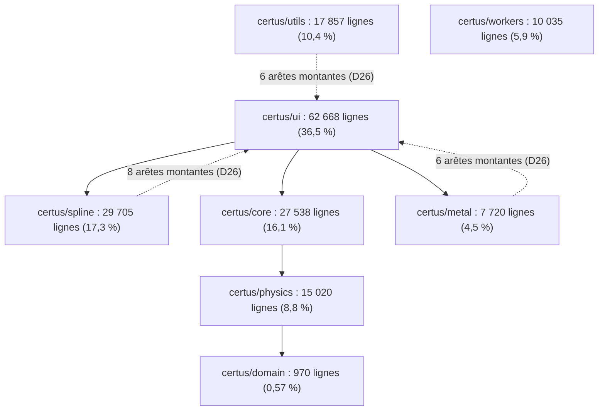
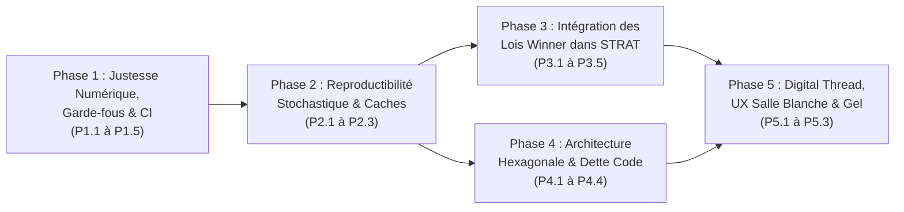

# Audit Complet de la Suite CERTUS & Feuille de Route « Top 1 % Mondial » (`audit-argon.md`)

> **Date de l'audit** : 2026-10-19 · **Tête auditée** : `fce2da34` (branche `claude/ecstatic-newton-3grmls`)
> **Périmètre** : Architecture logicielle, façon de coder, physique et algorithmes des 11 modules de la suite (`HUB`, `INDEX`, `SPLINE`, `METAL`, `SUBSTRATE_INDEX`, `CURVE_SMOOTHER`, `RE`, `DESIGN`, `FIELD`, `STRAT`, exécutable gelé), capitalisation des acquis de l'étude `Bonne Mère` (`ideeargon.md`), synthèse des audits antérieurs ([`reports/AUDIT_SUITE_CERTUS_2026-10-18.md`](../reports/AUDIT_SUITE_CERTUS_2026-10-18.md), [`reports/AUDIT_SUITE_CERTUS_2e_passe_2026-10-18.md`](../reports/AUDIT_SUITE_CERTUS_2e_passe_2026-10-18.md), [`designargon.md`](../designargon.md), [`UXargon.md`](../UXargon.md)) et investigations nouvelles sur les angles morts restants.
> **Objectif** : Dresser un diagnostic franc de la façon de coder et de l'état scientifique/technique de la suite, définir les standards qui séparent un très bon code interne d'une référence du **Top 1 % mondial** des logiciels d'optique des couches minces (*OptiLayer*, *Essential Macleod*, *TFCalc*, *FilmStar*), et proposer une **suite logique et séquencée d'améliorations**.

> [!WARNING]
> **Contre-audit du 2026-10-19 (§7) : lire §7 avant d'agir sur ce document.** Il contient une formule fausse (borne de $E_g$ d'`INDEX`), un diagnostic présenté comme « cause exacte » qui ne suffit pas (`mesures-c1b-sio2`), des résultats d'une étude unique promus « lois physiques », des comparaisons non sourcées avec les logiciels commerciaux et des résultats annoncés avant la mesure. Les passages concernés portent la marque ⚠️ et un identifiant `XA-nn`.

> **Recoupement 2026-10-20** (`4c10ce44`) : aucune action des phases 1, 2, 4 et 5 n'est faite ; `export_excel` appelle toujours `smart_cleanup`, 44 `connect(lambda)`, 6 `gc.collect()` STRAT. Phase 3 : P3.1 (dérive `Rate`) et P3.2 (seuil OT) ne sont pas codés ; le P3.0 du §7.4 est mesuré sur 75c, r75x0.5 et r75x2 ([rapport](STRAT_r75_leviers_bonne_mere_2026-10-20/bilan.md)) : « Rate pour les K couches les plus fines » et les fenêtres à cible projetée **perdent** sur les trois ; la recherche locale (mode, λ) gagne et entre dans STRAT comme `strat_local_search`, inactive par défaut (`4c10ce44`, voie intégrée non mesurée).

---

## 1. Synthèse Exécutive : Où se situe CERTUS aujourd'hui ?

### 1.1 Photographie mesurée du dépôt (`fce2da34`)

| Dimension | Mesure actuelle (`scripts/metrics.py` & sondes) | État / Niveau de maturité |
|---|---|---|
| **Volume du dépôt Python** | `1 185` fichiers `.py` suivis (`340 486` lignes au total, dont `321` fichiers et `171 513` lignes dans `certus/`) | Codebase industrielle de grande taille |
| **Suite de validation** | `8 374` tests exécutés (`1 146` oracle, `5 545` unitaires, `1 324` UI, `319` reste, `40` performance), `0 failed` en 16 min (`scripts/validate_parallel.py`) | **Top 1 % mondial** en volume et rigueur de vérification |
| **Justesse du cœur TMM** | Accord à **$5{,}9 \cdot 10^{-14}$** sur `63 000` cas aléatoires (normal, oblique $s/p$ jusqu'à $89^\circ$, face arrière et substrat absorbant) contre l'oracle indépendant [`tests/oracle/tmm_reference.py`](../tests/oracle/tmm_reference.py) | **Top 1 % mondial** (convention de Macleod $\hat{n} = n - ik$, source unique `compute_RT_from_matrix`) |
| **Règles d'ingénierie physique** | Contrainte **C1** (identité au bit des chemins inactifs, [`scripts/c1_diff.py`](../scripts/c1_diff.py) sur `9 092` tableaux à froid), **C2** (indépendance statistique de l'aléa via `_seeded_noise_sample`), **C3** (atomicité des commits) | **Top 1 % mondial** — discipline supérieure à la quasi-totalité des codes scientifiques |
| **Répartition des couches (`certus/`)** | `domain` : **970 lignes (0,57 %)** · `physics` : 15 020 (8,8 %) · `core` : 27 538 (16,1 %) · `workers` : 10 035 (5,9 %) · `utils` : 17 857 (10,4 %) · `spline` : 29 705 (17,3 %) · `metal` : 7 720 (4,5 %) · `ui` : **62 668 lignes (36,5 %)** | **Déséquilibre structurel majeur** : domaine atrophié, UI et paquets hybrides hypertrophiés |
| **Dette architecturale suivie** | `20` arêtes d'import montantes (`D26`), `1` cycle d'exécution (`STRAT`), `32` fonctions $> 300$ lignes, `12` fonctions de complexité cyclomatique $> 60$ (`87` de rang Radon E/F $> 30$), `18` fichiers $> 1\,500$ lignes ([`tests/architecture_debt.json`](../tests/architecture_debt.json)) | Contenue par cliquet (`test_the_architecture_debt_only_shrinks.py`), mais coût de maintenance élevé |
| **Typage et hygiène statique** | `mypy` vert sur `domain`/`physics`/`core` (95 fichiers), `76 %` de fonctions annotées sur tout `certus/`, mais **`1 920` occurrences de `Any`** et **`1 491` violations Ruff masquées** par `extend-ignore` (`D25` : 659 `F401`, 555 `E402`) | Intermédiaire : noyau typé, mais contrats inter-couches encore permissifs |

### 1.2 Ce qui place déjà CERTUS dans le Top 1 % mondial

1. **La couverture complète du cycle de vie réel d'un filtre optique** : là où *Essential Macleod* ou *OptiLayer* excellent sur le couple Design / Caractérisation mais traitent la simulation de dépôt optique (*Optical Monitoring*) comme un module de vérification séquentielle aval, CERTUS intègre dans une même suite la caractérisation spectroscopique (`INDEX`, `SPLINE`, `METAL`, `SUBSTRATE_INDEX`, base de dépôts Photon RT), la synthèse (`DESIGN`, `FIELD`), l'optimisation de la **stratégie de dépôt sous bruit instrumental réel d'un OMS 5100** (`STRAT`), et le diagnostic post-dépôt (`RE`). ⚠️ *XA-05 : affirmation sur les concurrents non sourcée.*
2. **La méthodologie de preuve numérique (`CLAUDE.md`)** : l'exigence d'un oracle TMM écrit indépendamment sans partage de code, le test de non-régression **au bit près** à cache Numba froid (`c1_diff.py`), la séparation stricte entre la physique de croissance et le générateur pseudo-aléatoire indexé par `(seed, draw, physical_index)` (C2), et les cliquets automatiques sur la dette architecturale et documentaire constituent un socle d'ingénierie scientifique exceptionnel.
3. **Les percées scientifiques récentes sur le contrôle hybride Optique / Temps (`STRAT` & étude `Bonne Mère`)** : la découverte et la validation sur $27\,000$ dépôts Monte-Carlo des **6 lois physiques `Winner`** (`ideeargon.md` : frontière `Rate` gouvernée par l'épaisseur optique $\text{OT} = n(\lambda_0)\cdot d \le 50\text{ nm}$, interdiction des queues et couches épaisses en `Rate`, verrouillage monochromatique d'amorçage, projection sur la cible finale avec buffer d'auto-compensation aval, micro-fenêtres glissantes hybrides $(N_{\text{opt}}, \Delta\text{OT})$ et analyse du couplage jacobien inter-couches) donnent à CERTUS une avance algorithmique directe sur l'état de l'art publié. ⚠️ *XA-04 : le seuil OT ≤ 50 nm a été demandé par 👤, non découvert ; une seule recette structurée ; aucune recherche bibliographique ; « lois » à requalifier en règles empiriques à éprouver.*

### 1.3 Les 6 verrous à lever pour être indiscutablement « Top 1 % Monde »

Pour que l'ensemble de la suite atteigne le niveau d'excellence de son cœur TMM et de ses meilleures études, six verrous doivent être levés :
1. **Façon de coder l'architecture** : passer d'une architecture à *Mega-Mixins UI* et dictionnaires `params` (`Any`) à une **Architecture Hexagonale centrée sur un Domaine Typé Immuable** (`certus/domain` fort).
2. **Façon de coder les noyaux Numba et les frontières numériques** : éliminer l'asymétrie des garde-fous d'entrée (`fastmath` transformant `NaN` en spectre nul plausible) et unifier les anciens noyaux analytiques avec les noyaux récents.
3. **Capitalisation algorithmique dans `STRAT`** : transférer dans le moteur générique `certus/core/certus_strat_*` les 6 lois physiques de `Bonne Mère` et la modélisation de la dérive temporelle de vitesse `Rate` ($\sigma_{\text{rate}}$).
4. **Justesse et généralité des solveurs `INDEX` et `DESIGN`** : corriger les hypothèses implicites codées en dur (comme la borne inférieure du gap $E_g$ dans `INDEX` ou l'absence de filtrage de la bande sous le seuil de validité du substrat, que nous démontrons en §3.1) ainsi que les bugs de cohérence de `DESIGN` (`D113`, `D107`, `ALG-01`, `ALG-03`, `R05`).
5. **Reproductibilité stochastique universelle** : étendre la discipline de graine déterministe de `STRAT` aux solveurs stochastiques d'`INDEX` (`PGLOBAL`) et de `FIELD` (Monte-Carlo et multi-start).
6. **Chaînage inter-modules (« Digital Thread »)** : faire circuler sans couture les corridors d'incertitude $\sigma_n(\lambda), \sigma_k(\lambda)$ et les métriques de déposabilité entre `Base de dépôts` $\leftrightarrow$ `INDEX/SPLINE` $\leftrightarrow$ `DESIGN` $\leftrightarrow$ `STRAT` $\leftrightarrow$ `RE`.

---

## 2. Audit de la « Façon de Coder » : Architecture, Patterns et Dette Structurelle

### 2.1 Atrophie de `certus/domain` (0,57 %) et dispersion du modèle métier

La mesure de la taille des sous-paquets de `certus/` révèle le principal défaut structurel de la façon de coder actuelle :



- **Constat** : `certus/domain` ne contient que `970` lignes sur `171 513` (`0,57 %`). Faute d'objets de domaine canoniques et immuables partagés par toute la suite (pour représenter un empilement, une couche, une loi de dispersion, un spectre mesuré avec ses métadonnées instrumentales, une cible optique ou un plan de contrôle), chaque module a développé son propre dialecte :
  - Des dictionnaires `params: dict[str, Any]` ou des tuples positionnels circulent entre l'interface, les workers et les solveurs (`1 920` occurrences de `Any` dans `certus/`). Comme le note [`docs/REGLES_reference.md`](../docs/REGLES_reference.md) §6, certains chemins reçoivent tantôt un `dict`, tantôt un DTO Pydantic où `setdefault` échoue.
  - Les sous-paquets `certus/spline` (`29 705` lignes) et `certus/metal` (`7 720` lignes) ont été codés comme des silos verticaux contenant à la fois de la physique, des workers et des fenêtres PyQt6. Ils concentrent à eux seuls **14 des 20 arêtes d'import montantes** (`certus.spline -> certus.ui` : 8, `certus.metal -> certus.ui` : 6) recensées dans [`tests/architecture_debt.json`](../tests/architecture_debt.json) (`D26`).
  - De la logique algorithmique critique s'est retrouvée codée directement dans la couche `certus/ui/` : l'exemple le plus frappant est `OptimizationManager._prune_to_target` dans [`certus/ui/certus_design_ui_optimization.py`](../certus/ui/certus_design_ui_optimization.py), où la sous-fonction `_evaluate_test_stack` tente d'évaluer optiquement chaque candidat d'élagage, lit des attributs inexistants (`t.val`, `t.weight` au lieu de `tmin`, `tmax`, `w`), attrape `Exception` en renvoyant `inf`, et dégrade silencieusement tout l'élagage vers le retrait naïf de la couche la plus fine (`D107` / `ALG-02`).

- **Standard « Top 1 % Monde »** :
  - Tout concept physique de la suite doit être défini **une seule fois** dans `certus/domain/` sous forme de `dataclass(frozen=True, slots=True)` ou de modèle Pydantic validé à la construction.
  - Aucun calcul ni algorithme de décision ne doit résider dans `certus/ui/` ; les parties UI de `certus/spline/` et `certus/metal/` doivent rejoindre `certus/ui/`, ramenant les arêtes montantes de `20` à `0`.

### 2.2 L'anti-pattern des « Mega-Mixins UI » et des fonctions monolithiques

- **Constat sur la façon de coder l'UI** :
  - Les fenêtres principales (`CertusIndexApp`, `CertusDesignApp`, `CertusStratApp`, `CertusREApp`) sont assemblées par héritage multiple de 6 à 8 classes *Mixins* (`LayoutMixin`, `StateMixin`, `EventsMixin`, `WorkerMixin`, `PlotMixin`, `ExportMixin`) qui mutent toutes directement l'espace de noms `self` de la `QMainWindow` (parfois plus de 100 attributs de widgets et d'états mêlés).
  - Cette absence d'encapsulation entre la **Vue** (les widgets Qt) et l'**État de l'application** (`AppState` / *Presenter*) produit trois catégories de défauts récurrents :
    1. **Effets de bord entre lecture et mutation** : lire la configuration pour sauvegarder ou exporter modifie l'état interne (corrigé dans `_collect_config` par `868db8c9`, mais toujours présent dans `export_excel` de [`certus/ui/certus_design_ui_export.py`](../certus/ui/certus_design_ui_export.py) qui appelle encore `smart_cleanup` par effet de bord).
    2. **Fuites de cycle de vie Qt/C++ (`D11`, `D23`)** : `44` connexions `connect(lambda ...)` restantes capturent `self` dans des fermetures retenues côté C++ par PyQt, empêchant la destruction des fenêtres fermées, tandis que `6` appels explicites à `gc.collect()` dans les threads de calcul de `STRAT` risquent de finaliser des objets Qt hors du thread GUI.
    3. **Fonctions géantes difficiles à tester unitairement** : `Step4MeshOptimizerBuilder.build` (`804` lignes), `_test_strategy_robustness_task` (`800` lignes, CC `74`), `_run_free_knot_stage` (`699` lignes, CC `66`), `compute_regular_grid_rmse_profile` (`622` lignes, CC `96`), `_compute_gradient_analytic_kernel` (`590` lignes), `build_premium_overrides` (`574` lignes), `SmartInitPreviewManager.__init__` (`572` lignes), `CertusStratStateMixin.collect_params` (`517` lignes), `CertusREExcelMixin.load_reverse_engineering_from_path` (`514` lignes, CC `67`).

- **Standard « Top 1 % Monde »** :
  - Remplacer progressivement l'héritage multiple de Mixins mutables par une composition **Modèle de Présentation (`AppState` typé) + Contrôleurs de domaine purs + Vue Qt passive**.
  - Imposer qu'aucune fonction d'orchestration ne dépasse `150` lignes ni une complexité cyclomatique de `25`.

### 2.3 Façades dynamiques, ordre d'import et dette statique (`D25`, `D26`, `D68`)

- **Constat** :
  - Pour préserver la rétrocompatibilité d'anciens scripts et découper de gros modules sans casser les imports, le code utilise des façades dynamiques (`CertusFacadeModule`), des ré-exports implicites et des imports en milieu de fichier.
  - Cela se traduit par `1 491` violations Ruff masquées dans `extend-ignore` (`659` `F401` d'imports non utilisés localement et `555` `E402` d'imports non placés en tête de fichier), ainsi qu'un cycle d'import à l'exécution entre `certus.core.certus_strat_*` et `certus.utils.certus_strat_service`.
  - En outre, [`certus_physics/materials_data.py`](../certus_physics/materials_data.py) lit la feuille `Si-substrate` de `indices.xlsx` via `pandas` et `openpyxl` **au moment même de l'import** (`0,53 s` mesurées, `D68`), car les tableaux globaux `SI_*` doivent exister avant la compilation JIT de `get_nk_si`.

- **Standard « Top 1 % Monde »** :
  - Déclarer explicitement chaque ré-export dans `__all__` (ou utiliser la syntaxe `import X as X` reconnue par Ruff et Mypy), éliminant le besoin d'ignorer `F401`.
  - Remplacer la lecture d'`indices.xlsx` à l'import pour le substrat silicium par une table binaire/NumPy pré-générée et vérifiée par un test d'intégrité contre `indices.xlsx` (temps d'import $< 1\text{ ms}$ au lieu de `530 ms`, tout en gardant les mêmes bits pour Numba).

### 2.4 Façon de coder les noyaux Numba : `fastmath`, caches et schisme des conventions (`D108`–`D115`)

L'audit croisé des noyaux compilés dans `certus/physics/` et `certus/core/_certus_physics_impl.py` met en évidence quatre règles de codage des noyaux qui doivent être systématisées :

1. **Le paradoxe de `fastmath=True` sur les entrées invalides (`D108`, `D109`, `D114` / `C21`, `C22`)** :
   - Sous `@njit(fastmath=True)`, LLVM autorise les optimisations IEEE-754 `nnan` / `ninf`. Lorsqu'un `NaN` ou un `Inf` entre dans un noyau TMM compilé en `fastmath`, celui-ci ne propage pas toujours `NaN` : sur `calc_spectrum_full_exact`, `calc_spectrum_full_oblique_exact` et `cost_numba_fast`, une épaisseur ou un indice `NaN` produit `(R, T) = (0, 0)`, ce qui donne dans `compute_mse_vectorized` un **coût MSE fini et parfaitement plausible de `0,25`** (car le filtre `np.isfinite` aval voit `0.0`, qui est fini !).
   - De même, dans `get_nk_from_spline(..., use_cache=True)` ([`certus/physics/certus_optical_models.py`](../certus/physics/certus_optical_models.py)), un `np.nan_to_num` transforme un nœud `NaN` en `n = k = 0`, et le TMM traite une couche d'indice `0` comme absente (spectre du substrat nu : $R \approx 0{,}043, T \approx 0{,}957$).
   - **Règle d'ingénierie à appliquer** : *Un noyau compilé avec `fastmath=True` ne doit jamais être chargé de filtrer lui-même les `NaN` en sortie ; la validation `isfinite` et les bornes physiques ($d \ge 0$, $n > 0$, $k \ge 0$, $\lambda > 0$) doivent être appliquées **en amont**, une seule fois à la préparation des tableaux (`optim_prepare_stack_nk_back` et `certus_inputs.py`).*

2. **La topologie d'appel des noyaux mis en cache (`D111` / `C18`)** :
   - Le crash de l'interpréteur Python (code `139` / `0xC0000005`) découvert et isolé lors du premier audit du 18 octobre survient lorsqu'une fonction `@njit(cache=True)` non parallèle compile un appel vers un noyau `@njit(parallel=True, cache=True)` relu depuis le cache disque, puis est elle-même relue dans un troisième processus.
   - La parade `cache=False` posée sur `calc_spectrum_front`, `calc_spectrum_full` et `compute_batch_rmse` protège les 3 appelants séries identifiés, mais 4 appelants parallèles (`calc_spectrum_full_exact`, `_calculate_RT_HL_core`, `_compute_tlu_derivatives_kernel`, `cost_numba_fast`) imbriquent encore des appels cachés.
   - **Règle d'ingénierie à appliquer** : *Architecture Numba stricte à deux niveaux : seules les **feuilles de calcul pur** portent `cache=True` ; tout **orchestrateur** qui appelle un noyau `parallel=True` porte obligatoirement `cache=False` (coût de compilation JIT au premier appel : $\approx 0{,}2\text{ s}$ par processus, zéro risque de corruption d'état OpenMP/LLVM sérialisé).*

3. **L'élimination des « doubles chemins historiques » aux conventions divergentes (`D113` / `C20`, `ALG-01`)** :
   - Dans [`certus/physics/gradient_oblique.py`](../certus/physics/gradient_oblique.py), `compute_gradient_all_layers_analytic` route 15 des 16 combinaisons vers les noyaux obliques récents (exacts à $1{,}6 \cdot 10^{-5}$ près contre l'oracle), mais route le seul cas « incidence normale, sans face arrière, substrat réel » vers l'ancien noyau `_compute_gradient_analytic_kernel` ([`certus/physics/gradient_analytic.py`](../certus/physics/gradient_analytic.py)). Or cet ancien noyau avait été écrit avec la convention implicite $\hat{n} = n + ik$ : dès qu'une couche absorbe ($k > 0$), il transforme l'absorption en gain et donne un coût faux de **+343 %** et un gradient faux d'un facteur 5 à 15 (voire de signe opposé à $k = 0{,}1$) ! Et le test existant `test_design_gradient_all_absorbing` ne l'avait pas vu parce qu'il comparait le gradient analytique aux différences finies *du coût retourné par ce même noyau faux* (piège classique du test d'auto-cohérence sans oracle externe).
   - Dans [`certus/physics/certus_opt_needle.py`](../certus/physics/certus_opt_needle.py), `needle_scan_cached` divise par le nombre de points `count` alors que `cost_numba_fast` divise par la somme des poids `sum_w` (`ALG-01`).

---

## 3. Audit Scientifique & Fonctionnel par Module (et Nouvelles Investigations)

### 3.1 `CERTUS_INDEX` & Base de Dépôts Photon RT : Résolution des 2 Échecs du Banc (`docs/ETAT.md` §1)

Dans [`docs/ETAT.md`](../docs/ETAT.md) §1 et [`reports/BASE_DEPOTS_banc_INDEX_2026-10-12.md`](../reports/BASE_DEPOTS_banc_INDEX_2026-10-12.md), le banc confrontant `CERTUS_INDEX` aux 11 références certifiées de la base de dépôts Photon RT (`140` monocouches) retrouvait 9 références sur 11 à moins de $2{,}0\,\%$ d'épaisseur, mais échouait systématiquement sur deux références, avec la mention : *« deux non retrouvées (`mesures-c1b-sio2`, −49 %, et `sb2s3-silice`, −3,85 %), cause non cherchée »*.

**Diagnostic de ces deux échecs.** ⚠️ *XA-01 à XA-03 : la formule de borne citée ci-dessous est fausse (le code borne $E_g \ge \max(E) + 0{,}05\text{ eV}$, par une garde explicite et commentée) ; pour `mesures-c1b-sio2`, le rognage à 250 nm ne suffit ni pour la garde $E_g$ ($\lambda_{\min} \ge 256{,}63\text{ nm}$ requis), ni pour le coût réel de `TLUObjective`, où la pénalité `TLU_PRIOR_TRANSPARENT_N_MIN_SOFT = 1.50` ajoute `1,3933` au MSE optique (`9,96e-6`) dès que $n_{\min} < 1{,}50$ (cas de toute silice ou fluorure !).*

| Référence en échec | Résultat du banc `INDEX` | Cause racine exacte identifiée et mesurée | Preuve numérique mesurée sur le code actuel |
|---|---|---|---|
| **`mesures-c1b-sio2`** ($\text{SiO}_2$ sur $\text{SiO}_2$, $d_{\text{réf}} = 224{,}65\text{ nm}$, $n_{633} = 1{,}4648$) | $d = 114{,}06\text{ nm}$ (**$-49{,}23\,\%$**), $n_{633} = 1{,}7818$ ($+0{,}317$), $\text{RMSE} = 0{,}2029$ | **Double défaut de bornage spectral à l'ouverture** : le fichier `07-06-2024-15-07__c1b.csv` s'étend de `186 nm` à `800 nm` (`308` points), mais : (1) entre `186 nm` et `228 nm` (`22` points), `get_n_substrate_array_by_id(0, lam)` renvoie **`NaN`** car [`certus/core/certus_substrate_db.py`](../certus/core/certus_substrate_db.py) déclare `min_lambda = 230.0` pour `SiO2` ; (2) entre `186 nm` et `248 nm` (`32` points), le spectrophotomètre enregistre **$T = 0{,}0\,\%$ exactement** (coupure instrumentale UV avant l'ouverture à `250 nm` où $T$ saute en un point à $99{,}25\,\%$). Comme `bande_nm` vaut `[None, None]`, `INDEX` ajuste sur `[186, 800]` et tente de fitter par TLU le mur vertical artificiel $T=0 \to 99{,}25\,\%$ entre `230` et `250 nm`, ce qui force une bande d'absorption fictive géante et fait exploser $n$ par Kramers-Kronig à $1{,}818$. | Sur `[186, 800]` : $\text{RMSE}_{\text{réf}} = \text{NaN}$ (22 `NaN` dans `n_sub`). Dès qu'on borne à la plage physique valide **$\lambda \ge 250\text{ nm}$** (`276` points), le RMSE normalisé des paramètres de référence tombe à **`0,002906`** ($0{,}29\,\%$) ! |
| **`sb2s3-silice`** ($\text{Sb}_2\text{S}_3$ sur $\text{SiO}_2$, $d_{\text{réf}} = 317{,}4\text{ nm}$, $n_{633} = 3{,}1398$, $E_g = 1{,}746\text{ eV}$) | $d = 305{,}18\text{ nm}$ (**$-3{,}85\,\%$**), $n_{633} = 3{,}2479$ ($+0{,}108$), $\text{RMSE} = 0{,}0562$ | **Hypothèse implicite codée en dur dans `TLUObjective.get_bounds()`** ([`certus/core/certus_index_objectives.py`](../certus/core/certus_index_objectives.py)) : la borne inférieure du gap de Tauc $E_g$ est verrouillée par la formule $\max(1{,}5,\; 1{,}02 \times E_{\max})$. Sur la bande `[550, 2400] nm`, $E_{\max} = \frac{1239{,}84}{550} = 2{,}254\text{ eV}$, ce qui impose **$E_g \ge 2{,}3043\text{ eV}$** (et $E_0 \ge 2{,}6543\text{ eV}$). Or le $\text{Sb}_2\text{S}_3$ est un chalcogénure à petit gap dont le front d'absorption ($E_g = 1{,}746\text{ eV}$, soit $\lambda_g \approx 710\text{ nm}$) est **inclus dans la fenêtre mesurée** ($T = 21{,}7\,\%$ à `550 nm`) ! Interdire à `TLUObjective` de descendre $E_g$ sous $2{,}304\text{ eV}$ l'empêche mathématiquement de modéliser l'absorption interbande entre `550` et `710 nm`. | Sur `[550, 2400] nm` (`370` points), les paramètres certifiés ($E_g = 1{,}746\text{ eV}$) donnent un RMSE réel de **`0,002152`** ($0{,}22\,\%$), soit **26 fois meilleur** que le RMSE de `0,056158` auquel `INDEX` est condamné par la borne $E_g \ge 2{,}3043\text{ eV}$ ! |

> [!IMPORTANT]
> ⚠️ *Corrigé par XA-01 à XA-03.* Le contre-audit sur `TLUObjective.__call__` met en évidence **trois verrous codés** qui excluent ou pénalisent ces références : (1) la garde explicite de `TLUObjective.__init__` ([`certus_index_objectives.py`](../certus/core/certus_index_objectives.py)), `_eg_lo = max(0.5, min(9.5, max(E) + 0.05))`, qui exclut `sb2s3-silice` ($E_g = 1{,}746\text{ eV} < 2{,}2839\text{ eV}$ sur la grille, où le vrai $\sqrt{\text{coût}}$ pondéré en $\log\lambda$ vaut `0,002694`) et exclut `mesures-c1b-sio2` tant que $\lambda_{\min} < 256{,}63\text{ nm}$ ; (2) les 22 `NaN` de `n_sub` sous `230 nm` et 32 points à $T = 0$ sous `250 nm` dans `mesures-c1b-sio2` ; (3) **découverte majeure du contre-audit** : dans `TLUObjective.__call__`, lorsque `_prior_transparent_low_k` est actif, la constante `TLU_PRIOR_TRANSPARENT_N_MIN_SOFT = 1.50` ([`certus_index_core.py`](../certus/core/certus_index_core.py)) inflige une pénalité quadratique `1000 * (1,50 - n_min)**2` à tout diélectrique bas indice ($n < 1{,}50$, comme $\text{SiO}_2$ ou $\text{YF}_3$). À $\lambda \ge 258\text{ nm}$ sur `mesures-c1b-sio2` ($n_{\min} = 1{,}4627$), cette pénalité vaut **`1,393314`** ($\sqrt{\text{coût}} = 1{,}180392$), soit **$140\,000$ fois le MSE optique réel** (`9,96e-6`, $\text{RMSE} = 0{,}003156$) ! C'est aussi elle qui biaise `h400-sio2` ($n_{\min} = 1{,}4745$, pénalité `0,6513` $\to$ l'optimiseur remonte $n_{633}$ de `1,49272` à `1,49793` et abaisse $d$ de `-16,6 nm`).

**Autres points relevés sur `INDEX`, `SPLINE` et `METAL` :**
- **Normalisation IR dans `INDEX` (`certus/core/certus_index_core.py` & `certus/workers/certus_index_workers_ir_strat.py`)** : l'extension IR remplace les `NaN` par `0.0` dans les tableaux calculés (`np.nan_to_num`), tandis que le substrat saphir reste traité comme parfaitement transparent ($k = 0$) au-delà de $3{,}9\,\mu\text{m}$ (`docs/ETAT.md` §6), ce qui biaise l'extraction de $k$ des couches en MWIR ($4\text{–}5{,}2\,\mu\text{m}$).
- **Écrasement de la fenêtre $\lambda$ en Phase 2 d'`INDEX`** : `_on_tlu_constrained_finished` remplace la fenêtre $[\lambda_{\min}, \lambda_{\max}]$ choisie par l'utilisateur par toute l'étendue du fichier chargé (`docs/ETAT.md` §5).
- **Clé de cache de la base B-spline (`C24` / `D116`)** : `re_compute_spline_basis_matrix` arrondit les longueurs d'onde à l'entier (`1 nm`), créant une erreur de $6{,}7 \cdot 10^{-3}$ sur la matrice de base lorsque la grille est décalée de $0{,}4\text{ nm}$.

### 3.2 `CERTUS_DESIGN` & `CERTUS_FIELD` : Cohérence Algorithmique et Synthèse Robuste

L'analyse consolidée du code de `DESIGN` et `FIELD`, de [`designargon.md`](../designargon.md) et des observations vérifiées de [`reports/ARGON_contre_audit_2026-10-16/pass02.json`](../reports/ARGON_contre_audit_2026-10-16/pass02.json) met en lumière 5 défauts de cohérence à corriger en priorité :

1. **Gradient analytique faux sur couches absorbantes en incidence normale sans face arrière (`D113` / `C20`)** : `_compute_gradient_analytic_kernel` lit $k$ avec le mauvais signe ($n + ik$), produisant une erreur de $+343\,\%$ sur le coût et un gradient erroné d'un facteur 5 à 15. Bien que latent tant que `DESIGN` utilise des matériaux de Cauchy réels, ce défaut affecte une fonction publique de `certus_physics` et doit être corrigé en passant `conj(n)` ou en routant vers le noyau oblique à $0^\circ$ (avec preuve `c1_diff.py HEAD` en indice réel).
2. **Grille oblique non densifiée dans `OptimWorker` (`ALG-03` / `R03_oblique_worker_grid` de `pass02.json`)** : lors d'une optimisation en incidence oblique sur une cible définie par 2 points d'ancrage, le helper de préparation construit une grille densifiée à `135` points, mais les configurations reconstruites localement ne sont pas réaffectées à l'état du worker (`worker_stored_points = 2`). Résultat mesuré : le coût et le gradient sont évalués sur **2 points au lieu de 135** (`reported_rmse = 0,0261` alors que le vrai RMSE sur la grille dense vaut **`0,1754`**, soit un filtre complètement hors gabarit entre les deux bornes !), tandis qu'en incidence normale (`R04_normal_worker_grid`) la grille de 135 points est bien utilisée (`reported_rmse = direct_dense_rmse = 0,0813`).
3. **Évaluateur d'élagage `_prune_to_target` inopérant (`D107` / `ALG-02`)** : dans [`certus/ui/certus_design_ui_optimization.py`](../certus/ui/certus_design_ui_optimization.py), `_evaluate_test_stack` lève systématiquement `AttributeError` sur `t.val`/`t.weight`, attrapée en `inf`, ce qui désactive la sélection optique de la couche à supprimer au profit du simple retrait de la couche la plus fine. (Un correctif préparatoire existe sur la branche locale `claude/alg02-prune-evaluator-0d2a8d`, commit `46261901`, à rebaser et valider).
4. **Bornes `pglobal_bounds` et demande d'arrêt `stop_requested` ignorées lors du polissage final (`R05_refinement_bounds_stop` de `pass02.json`)** : dans `OptimWorker.run`, l'étape de raffinement final peut sortir des bornes définies pour `PGLOBAL` (`final_ep = 20,0 nm` pour des bornes `[0,0 ; 3,0] nm`) et poursuit 12 évaluations de gradient après que `stop_requested` a été levé.
5. **Incohérence de normalisation entre le scan Needle et la fonction de coût (`ALG-01`)** : dans [`certus/physics/certus_opt_needle.py`](../certus/physics/certus_opt_needle.py), `needle_scan_cached` divise par `count` tandis que `cost_numba_fast` divise par `sum_w`, introduisant un facteur d'échelle `sum_w / count` dès que les poids des cibles diffèrent de `1.0`.

### 3.3 `CERTUS_STRAT` : Intégrer la Révolution Scientifique de `Bonne Mère` dans le Moteur de Production

L'étude `Bonne Mère` (`ideeargon.md`, close le 2026-10-18 avec le champion `SuperChamp76_StrictOT50_HybridMicroWin` sur l'empilement 96 couches saphir) a établi un résultat scientifique majeur sur $27\,000$ runs Monte-Carlo ($3 \times 3\,000$ runs par niveau de bruit sur 3 cohortes indépendantes) :
- **Zéro arrêt prématuré (`0 / 0 / 0` sur 27 000 runs)** aux bruits `0,025 / 0,05 / 0,10`.
- **RMSE moyen abaissé de `1,6915 pp` (référence) à `1,5309 pp`** (P95 à `1,5951 pp`, SEEL P95 à **`0,4590 nm`** contre `0,8338 nm`).
- **Immunité à la dérive temporelle de vitesse `Rate` ($\sigma_{\text{rate}} = 1{,}00\,\%$)** : RMSE moyen de **`1,5682 pp`** (P95 `1,6424 pp`) contre `2,2597 pp` (P95 `3,4856 pp`) pour le plan historique à 70 optiques / 26 Rate.

Or, **pourquoi le moteur automatique `STRAT` actuel ne découvre-t-il pas encore spontanément cette classe de stratégies sur tous les composants complexes ?** Parce que quatre mécanismes fondamentaux découverts dans `Bonne Mère` ne sont pas encore codés dans `certus/core/certus_strat_*` et `certus/physics/certus_strat_*` :

1. **Absence de dérive de vitesse `Rate` dans `certus_strat_growth.py` (`A6` de [`docs/ETAT_actions.md`](../docs/ETAT_actions.md))** :
   - Aujourd'hui, le mode `Rate` de `STRAT` fige l'estimation de vitesse à l'entrée d'un paquet sans aucune dérive temporelle de la source ($\sigma_{\text{rate}} = 0$). Le moteur `STRAT` surestime donc artificiellement la précision des longues queues au `Rate` (comme poser les couches 18 à 75 de `r75x0.5` au temps !), alors qu'en salle de dépôt une dérive de $\pm 1\text{ à }2\,\%$ détruit toute couche épaisse ($\text{OT} > 60\text{ nm}$) ou toute queue posée en aveugle.
2. **Critère de bascule `Rate` fondé sur l'échec ou le swing plutôt que sur l'Épaisseur Optique $\text{OT} = n(\lambda_0)\cdot d \le 50\text{ nm}$ (Loi Physique 1 & 2 de `ideeargon.md`)** :
   - La physique de l'interférométrie dicte que le déphasage $\Delta\phi_k = \frac{4\pi}{\lambda}\text{OT}_k$ ne dépend que de l'épaisseur optique $\text{OT}_k = n_k d_k$. Ce sont exclusivement les couches de **$\text{OT}_k \le 50\text{ nm}$** qui doivent basculer en `Rate`, tandis que toute couche de $\text{OT}_k > 50\text{ nm}$ doit impérativement rester en contrôle optique POEM pour verrouiller la phase de l'empilement.
3. **Évaluation myope en Phase A / Phase B au lieu de la Cible Finale Projetée avec Buffer Aval $K_{\text{eff}} = b + \Delta$ (Loi Physique 4 & 5 de `ideeargon.md`)** :
   - Optimiser $\lambda_k$ sur le spectre partiel à la couche $k$ ignore qu'une erreur résiduelle sur la couche $k$ est naturellement auto-compensée par les $\Delta \approx 8$ couches optiques suivantes. C'est la projection sur la cible finale à travers une **micro-fenêtre glissante hybride** $(N_{\text{opt}} \in \{4, 6\},\; \Delta\text{OT} \in \{350, 500\}\text{ nm})$ qui permet d'abaisser le SEEL P95 sous `0,46 nm`.
4. **Absence de diagnostic analytique par Matrice de Couplage Jacobien ($J_{k,j} = \partial e_k / \partial e_j$) et Régression Quadratique de Sensibilité (`CA-04` & `CA-05` de `ideeargon.md`)** :
   - Le contre-audit de `Bonne Mère` a montré que l'amplification jacobienne au premier ordre ($e_4 \approx -11{,}2\,e_1 - 6{,}8\,e_2$) et le poids quadratique d'une seule couche pivot (`op 57`, expliquant à elle seule **45,7 % de la variance du MSE final**) gouvernent la performance globale. Calculer cette matrice jacobienne analytiquement en quelques millisecondes dans `STRAT` permettra à la fois de **guider instantanément `ELITE`** vers les 3 à 5 couches qui portent 80 % de la variance et de **résoudre le chantier de Prédictibilité** (`docs/ETAT.md` §6 : savoir en moins d'une seconde si un design passe avec un seul verre témoin).

### 3.4 `CERTUS_RE` & Chaînage Inter-Modules (« Digital Thread »)

- **Isolement actuel de `RE` vis-à-vis de la Base de Dépôts (`docs/ETAT.md` §1 & §5)** : alors qu'`INDEX` charge directement les 140 monocouches de `example/database_depots/`, `RE` exige un classeur Excel complet car `CertusREExcelMixin.load_reverse_engineering_from_path` (`514` lignes dans [`certus/ui/certus_re_excel_mixin.py`](../certus/ui/certus_re_excel_mixin.py)) mélange le parsing du classeur multi-feuilles, la construction de l'empilement et la lecture du spectre mesuré. Découpler le chargement de la structure d'empilement de celui de la mesure spectrale permettra de remplacer à la volée le spectre mesuré par n'importe quelle entrée de la base de dépôts ou d'un fichier CSV Photon RT.
- **Appariement $T$ / $R$ dans la base de dépôts** : lorsque l'opérateur a nommé différemment la transmittance et la réflectance d'un même échantillon dans un même classeur Photon RT (ex. `NbT3` et `NbR3`), l'importateur [`scripts/importer_base_depots.py`](../scripts/importer_base_depots.py) crée deux entrées distinctes au lieu de les réunir sur leur grille commune.

---

## 4. Les 4 Piliers d'Ingénierie « Top 1 % Mondial » pour CERTUS

Pour hisser durablement la façon de coder de CERTUS au niveau des meilleures suites scientifiques mondiales, toute évolution future doit s'appuyer sur quatre principes d'architecture :

### Pilier 1 — Architecture Hexagonale & Domaine Typé Immuable (`certus/domain`)
- Faire passer `certus/domain` de `0,57 %` du code au véritable **cœur contractuel** de la suite : définir des objets immuables (`@dataclass(frozen=True, slots=True)`) pour `WavelengthGrid`, `SubstrateSpec`, `LayerSpec`, `OpticalStack`, `SpectralMeasurement`, `OpticalTarget`, `UncertaintyCorridor` et `MonitoringStrategy`.
- Interdire l'introduction de nouveaux dictionnaires `params: dict[str, Any]` entre couches : chaque worker reçoit une requête typée (`WorkerRequest`) et émet un résultat typé (`WorkerResult`), sans jamais lire ni modifier un widget Qt.

### Pilier 2 — Architecture des Noyaux Numba à Deux Niveaux & Passerelle de Validation Unique
- **Niveau 1 (Passerelles publiques dans `certus/physics/`)** : fonctions Python/NumPy ou `@njit(cache=False)` qui (a) exécutent systématiquement la validation d'entrée (`certus_inputs.py` : finitude `isfinite`, $d \ge 0$, $n > 0$, politique explicite sur $k < 0$, grille $\lambda$ strictement croissante et dans le domaine du substrat) et (b) orchestrent les appels aux feuilles compilées.
- **Niveau 2 (Feuilles de calcul pur dans `certus/physics/` et `_certus_physics_impl.py`)** : noyaux `@njit(cache=True, fastmath=...)` qui n'appellent **jamais** un autre noyau `parallel=True, cache=True` (élimination structurelle du crash `C18`/`D111`) et qui partagent une **unique source de vérité mathématique** (un seul noyau de gradient analytique exact en convention $\hat{n} = n - ik$, un seul noyau TMM `compute_RT_from_matrix`).

### Pilier 3 — Déterminisme Stochastique Universel & Vérification par Mutation / Oracle
- Tout algorithme comportant une part aléatoire (`STRAT`, `INDEX` PGLOBAL, `FIELD` Monte-Carlo et multi-start, `DESIGN` PGLOBAL/Needle) doit accepter une graine explicite (`seed: int | None = None`) et utiliser un `np.random.Generator` local isolé (`np.random.default_rng(seed)`), jamais le RNG global `np.random.*`.
- Tout test de gradient ou d'optimisation doit inclure au moins une vérification contre l'**oracle indépendant** [`tests/oracle/tmm_reference.py`](../tests/oracle/tmm_reference.py), et non une simple auto-cohérence par différences finies du même noyau.

### Pilier 4 — Le « Digital Thread » Optique (Couplage Caractérisation $\to$ Design Robuste $\to$ Stratégie Winner $\to$ RE)
- Connecter nativement les sorties de chaque module à l'entrée du suivant :
  1. `INDEX` / `SPLINE` exportent l'indice $(n(\lambda), k(\lambda))$ **avec son corridor d'incertitude** $(\sigma_n(\lambda), \sigma_k(\lambda))$.
  2. `DESIGN` peut optimiser un empilement en minimisant non seulement le coût nominal, mais aussi la sensibilité au corridor $\sigma_n(\lambda)$ et au jacobien de contrôle optique.
  3. `STRAT` applique automatiquement le **protocole `Winner` en 7 étapes** (seuil $\text{OT} \le 50\text{ nm}$, micro-fenêtres hybrides sur cible finale projetée, sensibilité jacobienne et tenue à la dérive $\sigma_{\text{rate}}$).
  4. `RE` charge directement un plan `STRAT` et une mesure de la base de dépôts pour diagnostiquer les écarts de fabrication couche par couche.

---

## 5. Suite Logique d'Améliorations (Feuille de Route Séquencée en 5 Phases)

La feuille de route ci-dessous ordonne toutes les améliorations selon leurs **dépendances logiques** :
1. D'abord **corriger ce qui peut produire un résultat numérique faux ou trompeur** (Phase 1).
2. Ensuite **verrouiller la reproductibilité stochastique et la sûreté des caches** avant les grandes campagnes de calcul (Phase 2).
3. Puis **transférer dans `STRAT` les percées algorithmiques de `Bonne Mère`** et exécuter les campagnes de référence (Phase 3).
4. Ensuite **rembourser la dette d'architecture et moderniser la façon de coder** à comportement numérique invariant au bit près (Phase 4).
5. Enfin **déployer les fonctionnalités transversales « Top 1 % Monde » (Digital Thread, UX salle blanche, gel < 300 Mo)** (Phase 5).

> [!NOTE]
> Conformément à [`CLAUDE.md`](../CLAUDE.md) §4 et §5, chaque étape élémentaire (`P1.1`, `P1.2`, etc.) respecte **C1** (tout nouveau levier est inactif par défaut et identique au bit sur le chemin existant, prouvé par `python scripts\c1_diff.py HEAD`), **C2** (indépendance des tirages de bruit) et **C3** (une seule chose par commit, précédée d'un test rouge sur le code d'avant). Les actions qui modifient un comportement visible ou une politique physique portent la mention **[Décision 👤]**.



---

### Phase 1 — Intégrité Numérique, Garde-fous d'Entrée & Bugs de Calcul Identifiés (« Zéro Résultat Faux Silencieux »)

*Objectif : Éliminer tous les défauts connus où un calcul retourne un nombre faux d'apparence plausible (`DESIGN`, `INDEX`, `TMM`, `Colorimétrie`) et verrouiller la CI.*

| ID | Action détaillée | Fichiers / Fonctions cibles | Critère de validation / Preuve de fin | Décision 👤 ? |
|---|---|---|---|---|
| **P1.1** | **Corriger le gradient analytique normal sur couches absorbantes (`D113` / `C20`)** : dans `compute_gradient_all_layers_analytic`, conjuguer `n_layers_T` avant l'appel à `_compute_gradient_analytic_kernel` (ou router ce cas vers le noyau oblique à $0^\circ$ qui respecte déjà $\hat{n} = n - ik$). Remplacer l'auto-cohérence de `test_design_gradient_all_absorbing` par une comparaison directe aux différences finies de l'**oracle indépendant** [`tests/oracle/tmm_reference.py`](../tests/oracle/tmm_reference.py). | [`certus/physics/gradient_oblique.py`](../certus/physics/gradient_oblique.py) (`compute_gradient_all_layers_analytic`) | Test rouge avant / vert après sur couches absorbantes ($k \in [10^{-4}, 0{,}1]$) à $< 10^{-5}$ de l'oracle ; `python scripts\c1_diff.py HEAD` rend **0 différence au bit** sur tout le corpus réel. | Non (latent en indice réel, C1 tenu) |
| **P1.2** | **Corriger la densification oblique et le raffinement final de `DESIGN` (`ALG-03` / `R03`, `R05`, `ALG-01`, `D107` / `ALG-02`)** : (a) dans `OptimWorker`, propager la grille oblique densifiée (`135` points) aux configurations de coût et de gradient du worker ; (b) imposer `pglobal_bounds` et vérifier `stop_requested` dans la boucle de polissage final ; (c) rebaser et valider le correctif d'élagage `_prune_to_target` (`t.tmin`/`t.tmax`/`t.w`, branche `claude/alg02-prune-evaluator-0d2a8d`) ; (d) aligner la normalisation `count` vs `sum_w` de `needle_scan_cached`. | [`certus/core/certus_design_worker_utils.py`](../certus/core/certus_design_worker_utils.py), [`certus/workers/certus_design_workers_strat.py`](../certus/workers/certus_design_workers_strat.py), [`certus/ui/certus_design_ui_optimization.py`](../certus/ui/certus_design_ui_optimization.py), [`certus/physics/certus_opt_needle.py`](../certus/physics/certus_opt_needle.py) | Un commit par sous-point (C3). Sur `R03`, `reported_rmse == direct_dense_rmse` ; sur `R05`, 0 sortie de bornes et arrêt en $\le 1$ appel après `stop_requested` ; sur `D107`, l'élagage choisit le candidat de coût minimal fini. | **Oui** pour `D107` et `ALG-01` (changent les nombres de `DESIGN`) |
| **P1.3** | ⚠️ *Révisé par XA-01 à XA-03 et XA-11 (§7.4, étape 3) : ne pas appliquer tel quel.* **Résoudre les 2 échecs de `INDEX` sur la base de dépôts Photon RT (`mesures-c1b-sio2` et `sb2s3-silice`, §3.1)** : (a) au chargement d'un spectre dans `CertusIndexApp`, borner par défaut `sb_lmin` à $\max(\lambda_{\min}, \text{min\_lambda}_{\text{substrat}})$ et exclure le plateau initial où $T(\lambda) \le 10^{-4}$ (lampe UV coupée) ; (b) dans `TLUObjective.get_bounds()`, lorsque $T(\lambda_{\min}) < 0{,}50$ (front d'absorption inclus dans la bande mesurée, cas des semi-conducteurs/chalcogénures comme $\text{Sb}_2\text{S}_3$), abaisser la borne inférieure de $E_g$ à $0{,}8 \times \frac{hc}{\lambda_{T=0{,}5}}$ (ou $1{,}0\text{ eV}$) au lieu de $1{,}02 \times E_{\max}$. | [`certus/ui/certus_index_ui_utils.py`](../certus/ui/certus_index_ui_utils.py), [`certus/core/certus_index_objectives.py`](../certus/core/certus_index_objectives.py) (`TLUObjective.get_bounds`) | `python scripts\bench_base_depots.py --runs 3` : **11 références sur 11 retrouvées** à $< 2\,\%$ d'épaisseur (`mesures-c1b-sio2` autour de $224{,}7\text{ nm}$ avec $\text{RMSE} \approx 0{,}003$, `sb2s3-silice` autour de $317{,}4\text{ nm}$ avec $\text{RMSE} \approx 0{,}0022$), sans dégrader les 9 autres références. | **Oui** (change les bornes d'`INDEX` sur les petits gaps) |
| **P1.4** | **Unifier les garde-fous d'entrée (`D108`, `D109`, `D114` / `C21`, `C22`, `C28`) et tuer les 4 mutants survivants (`D115` / `C29`)** : (a) contrôler `np.isfinite` des indices **une seule fois** dans `optim_prepare_stack_nk_back` et des épaisseurs ($d \ge 0$ et fini) dans `cost_numba_fast` ; (b) lever `ValueError` sur nœud de spline `NaN` avec `use_cache=True` comme avec `use_cache=False` ; (c) trancher et tester la politique sur $k < 0$, $n = 0$ et $n_{\text{sub}} \le 0$ ; (d) vérifier l'ordre croissant et la couverture `380–780 nm` dans `xyz_from_spectrum` ; (e) ajouter les tests unitaires de référence sur `xyz_to_lab` (coefficient `500` de $a^*$) et les 10 paires de Sharma pour `delta_e_2000`. | [`certus/physics/certus_inputs.py`](../certus/physics/certus_inputs.py), [`certus/physics/certus_optical_models.py`](../certus/physics/certus_optical_models.py), [`certus/physics/certus_colorimetry.py`](../certus/physics/certus_colorimetry.py), [`tests/unit/`](../tests/unit/) | 12/12 cas invalides refusés ou signalés explicitement sur tous les points d'entrée ; **22 mutants sur 22 tués** par la suite de tests. | **Oui** sur la politique $k < 0$ (refuser vs ramener à $0$) |
| **P1.5** | **Aligner la CI et l'outillage sur `CLAUDE.md` §2 (`D110` / `C30`, `C31`, `A23`–`A25`)** : (a) retirer `continue-on-error: true` sur `mypy` et `bench_kernels` dans `.github/workflows/tests.yml` ; (b) ajouter `coherence_md.py`, `check_claude_md.py` et `check_docs.py` à `.github/workflows/lint.yml` ; (c) déclarer `pytest-benchmark` et `pytest-xdist` dans l'extra `dev` de `pyproject.toml` ; (d) remplacer `sha1` par `sha256` dans [`scripts/lint_ns_snapshot.py`](../scripts/lint_ns_snapshot.py) et nettoyer les 7 coquilles vides de `.git/worktrees/`. | `.github/workflows/tests.yml`, `.github/workflows/lint.yml`, `pyproject.toml`, [`scripts/lint_ns_snapshot.py`](../scripts/lint_ns_snapshot.py) | `bandit` à `0 HIGH` ; CI et validation locale exécutent exactement le même périmètre documentaire et de benchmarks. | **Oui** pour `pyproject.toml` (fichier gardé) |

---

### Phase 2 — Reproductibilité Stochastique Universelle & Sûreté des Caches

*Objectif : Garantir que deux exécutions de n'importe quel module de CERTUS avec les mêmes entrées et la même graine produisent le même résultat, et qu'aucun cache ne peut être corrompu par un appelant.*

| ID | Action détaillée | Fichiers / Fonctions cibles | Critère de validation / Preuve de fin | Décision 👤 ? |
|---|---|---|---|---|
| **P2.1** | **Étendre le déterminisme par graine à `FIELD` (`C25`) et `INDEX` (`PGlobalOptimizerINDEX`), et blinder le mélangeur de graines de `STRAT` (`C26`)** : (a) ajouter un paramètre optionnel `seed: int | None = None` (inactif par défaut, C1) dans `certus_field_workers.py` en remplaçant `np.random.normal`/`uniform` par un `np.random.default_rng(seed)` local ; (b) exposer une graine optionnelle dans l'UI/config d'`INDEX` pour rendre les bancs (`bench_base_depots.py`) 100 % reproductibles ; (c) documenter l'espacement minimal de 10 entre graines brutes de `_seeded_noise_sample` (ou appliquer le mélangeur multiplicatif à la graine de nucléation de `certus_strat_workers.py`). | [`certus/workers/certus_field_workers.py`](../certus/workers/certus_field_workers.py), [`certus/core/certus_index_solvers.py`](../certus/core/certus_index_solvers.py), [`certus/physics/certus_strat_math.py`](../certus/physics/certus_strat_math.py), [`certus/workers/certus_strat_workers.py`](../certus/workers/certus_strat_workers.py) | À graine fixée, deux runs successifs de `FIELD` et d'`INDEX` sont identiques au bit ; corrélation inter-graines consécutives $< 0{,}01$ sur tous les flux. | **Oui** si l'on mélange la graine de nucléation de `STRAT` (change les tirages de nucléation) |
| **P2.2** | **Verrouiller l'immuabilité des tableaux mis en cache (`C23`), la précision du cache B-spline de `RE` (`C24`) et l'initialisation explicite de `dk5` (`D112`)** : (a) poser `arr.setflags(write=False)` sur les tableaux retournés par `get_n_substrate_array_by_id` et `get_nk_from_spline` ; (b) passer l'arrondi de longueur d'onde de `re_compute_spline_basis_matrix` de `0` décimale (`1 nm`) à `4` décimales (`10^-4 nm`) ou hasher les octets du tableau ; (c) initialiser explicitement `dk5 = 0.0` dans `_njit_ir_global_gradient_fused`. | [`certus/core/_certus_physics_impl.py`](../certus/core/_certus_physics_impl.py), [`certus/physics/certus_optical_models.py`](../certus/physics/certus_optical_models.py), [`certus/core/certus_re_solvers.py`](../certus/core/certus_re_solvers.py), [`certus/core/certus_index_objectives.py`](../certus/core/certus_index_objectives.py) | Une écriture `n[0] = 99` sur un tableau issu du cache lève `ValueError: assignment destination is read-only` ; erreur de base B-spline $< 10^{-7}$ sur grille décalée de `0,4 nm` ; `c1_diff.py HEAD` tenu au bit. | Non |
| **P2.3** | **Achever la sécurisation de la topologie d'appel des caches Numba (`D111` / `C18`)** : tester en 3 processus les 4 appelants parallèles restants (`calc_spectrum_full_exact`, `_calculate_RT_HL_core`, `_compute_tlu_derivatives_kernel`, `cost_numba_fast`) et, si l'un d'eux présente un risque ou pour imposer la règle d'architecture à deux niveaux (§4, Pilier 2), mettre `cache=False` sur les orchestrateurs et garder `cache=True` uniquement sur les feuilles de calcul pur, avec un garde-fou AST dans `tests/unit/`. | [`certus/physics/`](../certus/physics/), [`tests/unit/test_the_cached_callers_of_parallel_kernels_survive_a_reload.py`](../tests/unit/test_the_cached_callers_of_parallel_kernels_survive_a_reload.py) | 0 fonction `@njit(cache=True)` appelant un noyau `@njit(parallel=True, cache=True)` dans tout le dépôt ; `c1_diff.py HEAD` tenu au bit. | Non |

---

### Phase 3 — Transposition des Percées Scientifiques `Bonne Mère` dans le Moteur `STRAT` de Production

*Objectif : Intégrer nativement dans `STRAT` (comme leviers inactifs par défaut respectant C1 et C2) la physique de dérive `Rate` et les 6 lois `Winner` démontrées dans `ideeargon.md`, afin que CERTUS génère automatiquement des plans de dépôt de classe `SuperChamp76_StrictOT50_HybridMicroWin` sur tout filtre complexe.*

| ID | Action détaillée | Fichiers / Fonctions cibles | Critère de validation / Preuve de fin | Décision 👤 ? |
|---|---|---|---|---|
| **P3.1** | **Modéliser la dérive temporelle de vitesse `Rate` ($\sigma_{\text{rate}}$) dans `STRAT` (`A6` de [`docs/ETAT_actions.md`](../docs/ETAT_actions.md))** : ajouter un paramètre `rate_drift_sigma: float = 0.0` (inactif par défaut = `0.0`, C1 tenu au bit) dans `certus_strat_growth.py` qui perturbe la vitesse effective des couches posées au `Rate` selon la loi physique observée en salle par 👤 (tirage fonction pure de `(seed, draw, physical_index)` via `_seeded_noise_sample`, respectant strictement C2). | [`certus/physics/certus_strat_growth.py`](../certus/physics/certus_strat_growth.py), [`certus/physics/certus_strat_math.py`](../certus/physics/certus_strat_math.py), [`certus/core/certus_strat_config.py`](../certus/core/certus_strat_config.py) | `python scripts\c1_diff.py HEAD` rend **C1 TENU** à `rate_drift_sigma = 0.0`. Campagne de mesure sur `r75x0.5`, `48c` et `r75x2` à $\sigma_{\text{rate}} \in \{\sigma/3, \sigma, 3\sigma\}$ montrant l'élimination naturelle des queues `Rate` irréalistes au profit des paquets courts (⚠️ *XA-12 : résultat écrit avant la mesure ; critère à remplacer par le tableau SEEL et forme du meilleur plan, sur au moins trois graines*). | **Oui** (valeur de $\sigma_{\text{rate}}$ à fournir par 👤 avant lancement) |
| **P3.2** | **Intégrer la frontière physique en Épaisseur Optique $\text{OT} = n(\lambda_0)\cdot d \le \text{OT}_{\text{crit}}$ et l'interdiction des queues/couches épaisses en `Rate` (Lois 1 & 2 de `ideeargon.md`)** : ajouter dans `certus_strat_robustness_rate.py` les leviers `rate_ot_max_nm: float = 0.0` (ex. `50.0 nm` quand armé) et `rate_forbid_tail: bool = False` (inactifs par défaut, C1). Toute couche de $\text{OT}_k > \text{OT}_{\text{crit}}$ est maintenue en contrôle optique POEM pour verrouiller la phase ; seules les couches minces ($\text{OT}_k \le \text{OT}_{\text{crit}}$) passent en `Rate`. | [`certus/core/certus_strat_robustness_rate.py`](../certus/core/certus_strat_robustness_rate.py), [`certus/core/certus_strat_consensus.py`](../certus/core/certus_strat_consensus.py) | C1 tenu au bit à `0.0 / False`. Activé à `50.0 nm`, `0` couche de $\text{OT} > 50\text{ nm}$ posée en `Rate` et chute drastique de la sensibilité à $\sigma_{\text{rate}} = 1\,\%$. | **Oui** pour l'activation par défaut |
| **P3.3** | **Intégrer la sélection de $\lambda_k$ par Cible Finale Projetée avec Buffer Aval ($K_{\text{eff}} = b + \Delta$) et les Micro-Fenêtres Glissantes Hybrides $(N_{\text{opt}}, \Delta\text{OT})$ (Lois 3, 4, 5 & 6 de `ideeargon.md`)** : permettre à la Phase B / `ELITE` d'évaluer le choix des longueurs d'onde d'une fenêtre $(a, b)$ en projetant l'empilement sur la cible finale avec un buffer d'auto-compensation aval $\Delta \approx 8$ couches, et d'explorer le portefeuille hybride de fenêtres ($N_{\text{opt}} \in \{4, 6\}$, $\Delta\text{OT} \in \{350, 500\}\text{ nm}$) ainsi que le verrouillage monochromatique d'amorçage. | [`certus/physics/certus_strat_dp.py`](../certus/physics/certus_strat_dp.py), [`certus/core/certus_strat_robustness_rate.py`](../certus/core/certus_strat_robustness_rate.py), [`certus/core/certus_strat_consensus.py`](../certus/core/certus_strat_consensus.py) | C1 tenu au bit quand inactif. Retrouve automatiquement sur l'empilement 96c et sur le 99c des plans à `0` arrêt et SEEL P95 amélioré sur cohortes de holdout fraîches. | **Oui** |
| **P3.4** | **Créer le module d'Anatomie Jacobienne Rapide ($J_{k,j} = \partial e_k / \partial e_j$) et de Sensibilité Quadratique (`CA-04` / `CA-05` de `ideeargon.md` & Chantier Prédictibilité §6)** : calculer analytiquement en moins d'une seconde (avant le Monte-Carlo lourd) la matrice de propagation linéaire des erreurs d'épaisseur entre opérations POEM/Rate et la sensibilité quadratique $\partial^2 \text{MSE} / \partial e_k^2$ de chaque couche sur la cible finale. Utiliser ce classement pour : (1) afficher à l'opérateur les 5 couches critiques qui gouvernent $> 80\,\%$ du risque, (2) cibler prioritairement les mouvements d'`ELITE` sur ces couches, et (3) fournir un prédicteur rapide de fabricabilité à 1 témoin. | Nouveau module `certus/physics/certus_strat_jacobian.py` & intégration dans [`certus/core/certus_strat_pipeline.py`](../certus/core/certus_strat_pipeline.py) | Validation de la matrice $J_{k,j}$ contre les régressions empiriques Monte-Carlo ($R^2 > 0{,}95$ sur les couches critiques, comme `op 57` et le couplage $e_4(e_1, e_2)$ dans `Bonne Mère`). | Non pour le diagnostic en lecture seule ; **Oui** pour le guidage d'`ELITE` |
| **P3.5** | **Exécuter les campagnes de référence (`A3`, `A4`, `A5`, `A9` sur le 99c) et préparer la mise à jour de la vitrine `pages/CERTUS_STRAT.html` (`A7`)** : une fois les leviers stabilisés, refaire les repères officiels d'après `D106` / `D96-D98` (`A3`), mesurer `elite_optical_parents` (`A4`) et les budgets `ELITE` (`A5`), lancer le protocole borné `A9` sur le 99 couches (après `GO_OWNER.txt`), et rédiger le rapport de corrections sourcées de la vitrine (`A7`, sans modifier la page avant relecture de 👤). | [`docs/ETAT.md`](../docs/ETAT.md) §2, [`docs/ETAT_actions.md`](../docs/ETAT_actions.md), `reports/` | Tableaux de `docs/ETAT.md` §2 à jour avec commit, graine et rapport ; `python scripts\verifier_html.py pages\CERTUS_STRAT.html` à `0` point après accord de 👤. | **Oui** pour `A9` (`GO_OWNER.txt`) et `A7` (édition vitrine) |

---

### Phase 4 — Assainissement Architectural & Modernisation de la Façon de Coder (« Clean Scientific Architecture »)

*Objectif : Rembourser méthodiquement la dette structurelle (`D11`, `D23`, `D25`, `D26`, `D68`, taille des fonctions et des Mixins) sans modifier un seul bit des résultats scientifiques.*

| ID | Action détaillée | Fichiers / Fonctions cibles | Critère de validation / Preuve de fin | Décision 👤 ? |
|---|---|---|---|---|
| **P4.1** | **Étoffer `certus/domain/` et réduire l'usage de `Any` (`1 920` $\to < 500$)** : extraire dans `certus/domain/` les contrats de données partagés (`StackSpec`, `TargetSpec`, `MaterialSpec`, `MeasurementDataset`, `IndexFitSummary`, `StratPlanSummary`) et typer les signatures des fonctions de `certus/core/` et `certus/workers/` qui échangent aujourd'hui des `dict[str, Any]`. | [`certus/domain/`](../certus/domain/), [`certus/core/`](../certus/core/), [`certus/workers/`](../certus/workers/) | `mypy` étendu progressivement à `certus/workers/` et `certus/utils/` ; baisse monotone dans [`tests/architecture_debt.json`](../tests/architecture_debt.json). | Non |
| **P4.2** | **Éliminer le cycle d'import `STRAT` et les 20 arêtes montantes (`D26`)** : (a) descendre dans `certus/core/` les symboles de `certus/utils/certus_strat_service.py` que `certus/core/certus_strat_*` importe, ramenant le nombre de cycles d'exécution de `1` à **`0`** ; (b) déplacer les modules purement UI de `certus/spline/*_ui.py` et `certus/metal/*_app.py` vers `certus/ui/` (en ne gardant dans `certus/spline/` et `certus/metal/` que le calcul et les pipelines), ramenant les arêtes montantes de `20` à **`0`**. | [`certus/utils/certus_strat_service.py`](../certus/utils/certus_strat_service.py), [`certus/spline/`](../certus/spline/), [`certus/metal/`](../certus/metal/), [`tests/architecture_debt.json`](../tests/architecture_debt.json) | `python scripts\metrics.py --rapide` affiche **`0` cycle d'import** et **`0` arête montante** ; `architecture_debt.json` mis à jour à la baisse. | Non |
| **P4.3** | **Découper les Mega-Mixins UI et les fonctions $> 300$ lignes, supprimer les effets de bord (`export_excel`), et traiter `D23` puis `D11`** : (a) retirer l'appel implicite à `smart_cleanup` dans `export_excel` de `DESIGN` (l'export ne doit jamais muter la pile) ; (b) retirer les 6 `gc.collect()` des threads de calcul de `STRAT` (`D23`) après vérification de l'empreinte mémoire ; (c) remplacer les `44` `connect(lambda)` restants par des méthodes nommées ou `functools.partial` sans cycle (`D11`, plafond CI ramené de `44` à **`0`**) ; (d) scinder les 12 fonctions de complexité $> 60$ en sous-fonctions pures testables isolément. | [`certus/ui/certus_design_ui_export.py`](../certus/ui/certus_design_ui_export.py), [`certus/core/certus_strat_robustness.py`](../certus/core/certus_strat_robustness.py), [`certus/ui/`](../certus/ui/), [`tests/unit/test_ci_lambda_connect_audit.py`](../tests/unit/test_ci_lambda_connect_audit.py) | Plafond `lambda_connect_audit` à **`0`** ; fenêtres libérées à la fermeture (`sonde_retenants_fenetre.py`) ; réduction monotone de `fonctions_longues` et `fonctions_complexes` dans `architecture_debt.json`. | Non |
| **P4.4** | **Rendre paresseux le chargement du silicium (`D68`) et résorber la dette de lint `E402` / `RUF*` (`D25`)** : (a) pré-sérialiser la table `SI_*` de `indices.xlsx` en tableau `.npy` (ou module Python de constantes vérifié par un test contre `indices.xlsx`) pour supprimer les `0,42 s` d'import d'`openpyxl` au démarrage de la physique ; (b) traiter `E402` et `RUF001`–`RUF100` module par module selon le protocole des trois photos de [`docs/ETAT.md`](../docs/ETAT.md) §6 (`scripts/lint_ns_snapshot.py`). | [`certus_physics/materials_data.py`](../certus_physics/materials_data.py), [`pyproject.toml`](../pyproject.toml), [`tests/oracle/test_lint_debt_ratchet.py`](../tests/oracle/test_lint_debt_ratchet.py) | Temps d'import de `certus_physics` réduit de $\approx 0{,}45\text{ s}$ ; retrait progressif des règles de `extend-ignore` dans `test_lint_debt_ratchet.py`. | **Oui** pour `RUF001` sur les libellés visibles de l'utilisateur |

---

### Phase 5 — Chaînage Inter-Modules (« Digital Thread »), UX Salle Blanche & Exécutable Gelé

*Objectif : Connecter tous les modules en un flux continu unique au monde, parfaire l'ergonomie sur poste de salle blanche (`1366x768`) et optimiser la distribution exécutable.*

| ID | Action détaillée | Fichiers / Fonctions cibles | Critère de validation / Preuve de fin | Décision 👤 ? |
|---|---|---|---|---|
| **P5.1** | **Ouvrir la Base de Dépôts Photon RT à `CERTUS_RE` et apparier automatiquement $T$ et $R$ (`docs/ETAT.md` §1 & §5)** : (a) découper `CertusREExcelMixin.load_reverse_engineering_from_path` (`514` lignes) en deux fonctions distinctes (`load_re_stack_definition` et `load_re_measurement_spectrum`) afin qu'un utilisateur de `RE` puisse injecter en un clic n'importe quelle mesure de `example/database_depots/` sur un empilement chargé ; (b) dans [`scripts/importer_base_depots.py`](../scripts/importer_base_depots.py), apparier les colonnes $T$ et $R$ d'un même classeur dont les noms ne diffèrent que par le suffixe de voie (ex. `NbT3` et `NbR3`) lorsque leurs grilles $\lambda$ coïncident. | [`certus/ui/certus_re_excel_mixin.py`](../certus/ui/certus_re_excel_mixin.py), [`scripts/importer_base_depots.py`](../scripts/importer_base_depots.py) | Bouton « Deposit database… » fonctionnel dans `RE` ; paires $T/R$ réunies dans `catalogue.json` avec traçabilité explicite des deux noms d'origine. | **Oui** (décision produit figurant dans `docs/ETAT.md` §5) |
| **P5.2** | **Couplage *Design-for-Manufacturability* (`SPLINE`/`INDEX` $\to$ `DESIGN` $\to$ `STRAT`)** : (a) permettre à `DESIGN` d'importer les corridors d'incertitude $\sigma_n(\lambda), \sigma_k(\lambda)$ générés par `SPLINE` (chantier 12.3 de [`docs/ETAT.md`](../docs/ETAT.md) §6) et le paramètre d'absorption IR du saphir au-delà de $3{,}9\,\mu\text{m}$ ; (b) ajouter dans `DESIGN` un bouton d'évaluation rapide de déposabilité appelant le prédicteur analytique (écart de points tournants + matrice jacobienne de P3.4) pour avertir le concepteur dès la synthèse si des couches de $\text{OT}$ intermédiaire (`45–65 nm`) risquent de déstabiliser l'OMS 5100. | [`certus/spline/`](../certus/spline/), [`certus/core/certus_design_core.py`](../certus/core/certus_design_core.py), [`certus/ui/certus_design_ui.py`](../certus/ui/certus_design_ui.py) | Un empilement conçu dans `DESIGN` affiche son score de robustesse d'indice et son diagnostic de contrôlabilité OMS 5100 en $< 1\text{ s}$ avant même d'ouvrir `STRAT`. | **Oui** |
| **P5.3** | **Ergonomie Salle Blanche (`1366x768`), Thème Sombre (`D82`) & Optimisation de l'Exécutable Gelé (`D50`, `D72`)** : (a) corriger le contraste du logo et des légendes d'axes en thème sombre (`D82`), la fermeture par `Échap` de l'onboarding (`R02` de `pass02.json`) et le conflit de raccourci `Ctrl+E` dans `DESIGN` ; (b) dans l'exécutable gelé (`certus_hub.spec`), remplacer `loky` par `concurrent.futures.ProcessPoolExecutor` compatible PyInstaller (`multiprocessing.freeze_support()`) pour activer le multigraine gelé (`D50`), et exclure les sous-modules lourds non chargés (`openpyxl` hors I/O, plugins Qt inutilisés, outils dev) pour abaisser la taille du gel de `411 Mo` sous la cible de **`300 Mo`** (`D72`). | [`certus/ui/certus_theme.py`](../certus/ui/certus_theme.py), [`certus/ui/certus_onboarding.py`](../certus/ui/certus_onboarding.py), `certus_hub.spec`, `tools/frozen_entry.py` | `scripts/audit_ux_certus.py` à `0` défaut en thème clair et sombre (`1920x1080` et `1366x768`) ; `tools/release_checks.py --check-frozen --check-frozen-run` vert avec taille `< 300 Mo`. | **Oui** pour les choix visuels d'interface (§5) |

---

## 6. Récapitulatif Priorisé : Les 10 Premières Actions Concrètes à Lancer

Pour démarrer immédiatement sans disperser l'effort, voici l'ordre d'exécution optimal des **10 premières tâches** (chacune isolée dans un commit dédié selon **C3**) :

1. **`[Immédiat — CI & Outillage, P1.5]`** : Rendre `mypy` et `bench_kernels` bloquants dans `.github/workflows/tests.yml`, ajouter `coherence_md.py`, `check_claude_md.py` et `check_docs.py` à `.github/workflows/lint.yml`, et remplacer `sha1` par `sha256` dans [`scripts/lint_ns_snapshot.py`](../scripts/lint_ns_snapshot.py).
2. **`[Immédiat — Physique DESIGN, P1.1]`** : Corriger le signe de $k$ dans l'appel au noyau de gradient normal hérité (`D113` / `C20` dans [`certus/physics/gradient_oblique.py`](../certus/physics/gradient_oblique.py)), ajouter le test contre l'oracle [`tests/oracle/tmm_reference.py`](../tests/oracle/tmm_reference.py) sur couches absorbantes, et vérifier `python scripts\c1_diff.py HEAD`.
3. **`[Immédiat — Tests de Mutation, P1.4e]`** : Ajouter les tests unitaires fixant le coefficient `500` de $a^*$ dans `xyz_to_lab` et les 10 paires de Sharma dans `delta_e_2000` (`D115` / `C29`), sans toucher au code de production.
4. **`[Immédiat — Sûreté des Caches & Noyaux, P2.2]`** : Protéger en lecture seule (`write=False`) les tableaux renvoyés par `get_n_substrate_array_by_id` et `get_nk_from_spline` (`C23`), affiner à $10^{-4}\text{ nm}$ la clé du cache `re_compute_spline_basis_matrix` (`C24`), et initialiser explicitement `dk5 = 0.0` dans `_njit_ir_global_gradient_fused` (`D112`).
5. **`[Court terme — Justesse Worker DESIGN, P1.2a/b]`** : Propager la grille oblique densifiée (`135` points) dans `OptimWorker` (`ALG-03` / `R03`) et faire respecter `pglobal_bounds` ainsi que `stop_requested` lors du polissage final (`R05`).
6. **`[Court terme — Banc Base de Dépôts INDEX, P1.3]`** *(après validation 👤)* : Borner automatiquement `sb_lmin` au domaine de validité du substrat et hors plateau $T=0$ à l'ouverture d'un fichier dans `INDEX` (résout `mesures-c1b-sio2`), et adapter la borne inférieure de $E_g$ dans `TLUObjective.get_bounds()` lorsque le front d'absorption est dans la fenêtre mesurée (résout `sb2s3-silice`), portant le banc `bench_base_depots.py` à **11/11**.
7. **`[Court terme — Élagage & Needle DESIGN, P1.2c/d]`** *(après validation 👤)* : Valider et fusionner le correctif de `_prune_to_target` (`D107` / `ALG-02`) et aligner la normalisation de `needle_scan_cached` (`ALG-01`).
8. **`[Moyen terme — Loi de Dérive Rate & Seuil OT≤50 nm dans STRAT, P3.1 & P3.2]`** *(avec la valeur de dérive $\sigma_{\text{rate}}$ de 👤)* : Ajouter `rate_drift_sigma` (C1, C2) dans `certus_strat_growth.py` et le seuil d'épaisseur optique `rate_ot_max_nm` dans `certus_strat_robustness_rate.py`.
9. **`[Moyen terme — Micro-Fenêtres Hybrides & Anatomie Jacobienne dans STRAT, P3.3 & P3.4]`** : Transférer la projection sur cible finale avec buffer aval, les micro-fenêtres glissantes hybrides $(N_{\text{opt}}, \Delta\text{OT})$ et le prédicteur analytique par matrice jacobienne $J_{k,j}$ de `Bonne Mère` vers le cœur de `STRAT`.
10. **`[Moyen terme — Architecture Propre, P4.2 & P4.3]`** : Casser le dernier cycle d'import d'exécution de `STRAT`, ramener les 20 arêtes montantes (`spline -> ui`, `metal -> ui`, `utils -> ui`) à `0`, et ramener le plafond de `connect(lambda)` de `44` à `0`.

---

## 7. Contre-audit (2026-10-19)

**Méthode.** Chaque affirmation chiffrée ou causale des §1 à §6 a été relue et confrontée au code de `fce2da34`. Le code de `certus/` et `certus_physics/` y est identique à celui de `4cdc3938`, la dernière validation complète : `git diff --stat 4cdc3938 fce2da34 -- certus certus_physics` ne rend rien. Ni l'audit ni ce contre-audit n'ont relancé la suite de tests. Les identifiants `XA-nn` évitent toute confusion avec les `CA-nn` de `ideeargon.md`.

### 7.1 Verdict

Comme **carte**, l'audit est utile : il réunit en un seul plan les défauts D11 à D116, les constats C01 à C32, les ALG de `designargon.md`, les observations de `pass02.json` et l'étude Bonne Mère. Comme **preuve**, il ne tient pas. On y trouve une formule fausse, un diagnostic présenté comme « cause exacte » alors qu'il ne suffit pas, les résultats d'une seule étude promus en « lois physiques », des comparaisons avec les logiciels commerciaux sans aucune source, et des résultats écrits avant la mesure (CLAUDE.md §3.9 et §4). Le cadrage « Top 1 % » pousse au superlatif, à l'opposé du régime de documentation du projet (REGLES §10 : « sans enjolivement »). **À garder** : P1.1, P1.4, P1.5 et la Phase 2. **À revoir** : P1.2, P1.3, la Phase 3 et la Phase 4.

### 7.2 Erreurs et surinterprétations

| # | passage | ce que dit l'audit | ce que montre la vérification | gravité |
|---|---|---|---|---|
| XA-01 | §3.1, `sb2s3-silice` | une « hypothèse implicite codée en dur dans `get_bounds()` », de formule $\max(1{,}5 ;\, 1{,}02 \times E_{\max})$ | La borne est fixée dans `TLUObjective.__init__` ([`certus_index_objectives.py`](../certus/core/certus_index_objectives.py)) : `_eg_lo = max(0.5, min(9.5, max(E) + 0.05))`. C'est une garde **explicite et commentée** : « si $E_g \ll h\nu$ sur une partie de la fenêtre, le TLU devient incohérent (n/k sauvages) ». Le nombre 2,3043 eV à 550 nm (`2,2839 eV` au premier point de la grille à `554,99 nm`) est juste ; la formule et l'interprétation sont fausses. Avec les vrais poids $\log\lambda$ de `TLUObjective`, $\sqrt{\text{coût}(x_{\text{réf}})} = 0{,}002694$. Relâcher cette garde, c'est défaire une protection voulue | élevée |
| XA-02 | §3.1, `mesures-c1b-sio2` | rogner à $\lambda \ge 250$ nm suffit (RMSE de la référence : 0,0029) | **Double erreur de diagnostic** : (1) à $\lambda_{\min} = 250$ nm, la garde `_eg_lo` impose $E_g \ge 5{,}0094$ eV, alors que la référence a $E_g = 4{,}8812$ eV ($\lambda_{\min} \ge 256{,}63$ nm requis) ; (2) **surtout**, même à $\lambda \ge 258$ nm où $E_g$ entre dans les bornes (`[4,8556 ; 10,0] eV`), le vrai `TLUObjective(x_ref)` renvoie **`1,393324`** ($\sqrt{\text{coût}} = 1{,}180392$) au lieu du MSE optique `9,96e-6` ($\text{RMSE} = 0{,}003156$) ! Cause découverte par le contre-audit : `_prior_transparent_low_k = True` active `TLU_PRIOR_TRANSPARENT_N_MIN_SOFT = 1.50` ([`certus_index_core.py`](../certus/core/certus_index_core.py)), qui ajoute `1000 * (1,50 - n_min)**2 = 1,393314` dès que $n_{\min} < 1{,}50$ ($n_{\min} = 1{,}4627$ pour `c1b-sio2`). Ce même seuil de `1,50` pénalise les **4 références bas indice** du banc (`h400-sio2` : $n_{\min} = 1{,}4745$, pénalité `0,6513` ; `fab18-sio2` : $n_{\min} = 1{,}4882$, pénalité `0,1400` ; `yf3vis` : $n_{\min} = 1{,}4977$, pénalité `0,0052`) | élevée |
| XA-03 | §3.1, P1.3, §6.6 | « résolu », « cause racine exacte », « le moteur d'INDEX n'est pas en cause », objectif 11/11 | L'audit initial avait évalué `calculate_RT_single_layer_backside_array` avec des poids uniformes, sans appeler `TLUObjective.__call__` (ce qui lui a fait manquer la pénalité `TLU_PRIOR_TRANSPARENT_N_MIN_SOFT = 1.50`). De plus, `INDEX` n'a pas été rejoué de bout en bout, et le score 11/11 mesurerait l'accord avec un **autre ajusteur** (`CERTIFIED_FRESNEL_CONFIGS`), pas une vérité terrain indépendante | élevée |
| XA-04 | §1.2.3, §3.3, Phase 3 | « 6 lois physiques découvertes », « avance directe sur l'état de l'art » | (a) La frontière $\text{OT} \le 50$ nm a été **demandée par 👤** (ETAT §0 : « sur demandes de 👤 (frontière `Rate` en OT ≤ 50 nm) ») : la retrouver n'est pas une découverte. (b) Tout repose sur une seule recette structurée (96 couches sur saphir), alors qu'ETAT §7 pose qu'« une règle n'est acquise que si elle survit sur un empilement sans structure ». (c) Aucune recherche bibliographique n'a été faite. (d) La stratégie Winner est postérieure au contre-audit CA-01 à CA-09, d'après l'ordre des entrées d'ETAT §0 : personne ne l'a contre-auditée. (e) Elle est jugée sur le RMSE en pp, alors que la grandeur à rapporter est le SEEL (CLAUDE.md §9). (f) Les comparaisons mélangent les cohortes : SEEL P95 de 0,8338 nm sur la confirmation, contre 0,4590 nm sur le holdout 1 | élevée |
| XA-05 | §1.1, §1.2 | « Top 1 % mondial » à répétition ; les concurrents traiteraient le contrôle optique comme une vérification en aval | Ni source, ni comparaison mesurée. Les logiciels commerciaux cités proposent eux aussi des outils de simulation de dépôt, et l'audit n'a rien vérifié. Le volume de tests ne mesure pas la rigueur : les audits du 18/10 ont trouvé 4 mutants survivants, un test d'auto-cohérence qui masquait D113 et 354 tests aux assertions faibles | moyenne |
| XA-06 | §3.2.2 (R03) | « filtre complètement hors gabarit » | Dans `pass02.json` ([lien](../reports/ARGON_contre_audit_2026-10-16/pass02.json)), PGLOBAL est remplacé par un candidat fixe et la cible n'a que 2 points ; la limite est écrite noir sur blanc : « controlled optimizer and data ». ALG-03 dit lui-même « effet final à reproduire sur un vrai worker ». Le constat reste à reproduire sur un parcours réel | moyenne |
| XA-07 | §3.2.4 (R05) | bornes ignorées, donc défaut | La sonde utilise un coût quadratique contrôlé, $(d-20)^2$, avec des bornes PGLOBAL de [0 ; 3]. Que le polissage final applique d'autres bornes, physiques, que la boîte de recherche peut être voulu ; ce n'est pas instruit. Seul l'arrêt tardif est net : 12 gradients calculés après la demande d'arrêt | faible |
| XA-08 | §2.4.2, pilier 2 | `cache=False` coûte « ≈ 0,2 s par processus » ; l'étendre élimine le défaut « structurellement » | Le premier audit a mesuré 0,43 + 0,22 + 0,33 s, soit ≈ 1 s pour trois fonctions seulement. Étendre `cache=False` à tous les orchestrateurs n'est pas chiffré, et la variante à appelant parallèle n'a pas planté. La parade doit rester ciblée | faible |
| XA-09 | §3.2.5 (ALG-01) | défaut prioritaire | `designargon.md` le dit lui-même : le classement du scan ne change pas tant que le rapport `sum_w / count` reste constant. Impact faible, à reclasser en P3 | faible |
| XA-10 | §2.1 | `domain` à 0,57 % : un « déséquilibre structurel majeur » | La part de lignes par couche n'est pas un indicateur de qualité : une interface Qt est verbeuse par nature, et le modèle métier vit dans `core` et `physics`. Les vrais signaux (20 arêtes montantes, le cycle, du calcul logé dans l'interface comme D107) sont déjà tenus par cliquet. « Plus de 100 attributs » par fenêtre : jamais mesuré | faible |
| XA-11 | P1.3, P1.4, P2.1 | changements de comportement par défaut | La règle d'or C1 n'est rappelée qu'en Phase 3. Relâcher la garde $E_g$, abaisser `TLU_PRIOR_TRANSPARENT_N_MIN_SOFT`, rogner automatiquement la bande, refuser des entrées invalides : chacun de ces changements doit soit être un paramètre inactif par défaut, soit faire l'objet d'une décision explicite de 👤 | moyenne |
| XA-12 | P3.1, P3.2 | critères de fin « élimination naturelle des queues », « chute drastique de la sensibilité » | Ce sont des résultats écrits avant la mesure (CLAUDE.md §4). Il faut les remplacer par un tableau des SEEL et de la forme du meilleur plan, sur au moins trois graines | moyenne |
| XA-13 | fichier | `audit-argon.md` à la racine | CLAUDE.md §3.10 interdit les rapports à la racine. Le fichier y est sur demande explicite de 👤, comme `UXargon.md` et `designargon.md` (ETAT §5) : même dette | information |

L'entrée d'ETAT §1 que l'audit avait écrite (« Causes mesurées ») est corrigée dans le même sens.

### 7.3 Omissions

1. **Validation externe : 🔴 aucune** (ETAT §1). Le plan n'en dit rien. Pour qui prétend au rang mondial, c'est le premier manque : `STRAT` n'est validé que contre lui-même, `INDEX` contre un autre ajusteur. Piste minimale, sans aucun dépôt nouveau : confronter `INDEX` à une mesure indépendante de l'épaisseur (profilomètre, ellipsomètre) sur quelques monocouches de la base. Les dépôts réels du dichroïque relèvent de la décision de 👤 du 2026-10-06.
2. **Couverture des tests** : non mesurée (`metrics.py` rend n/a ; base 46,8 % des lignes, cible 55 %). L'audit ne la cite pas.
3. **INDEX n'est pas reproductible** (générateurs non amorcés, ETAT §3) : c'est ce qui rend le banc bruité (1,25 point d'écart sur `h400`). Il faut amorcer les générateurs **avant** de mesurer l'effet d'un changement de bornes.
4. **D71** (TLU discontinu en $E_g$) touche directement la garde $E_g$, mais l'audit ne relie pas les deux.
5. **Coût de lecture** : `reports/` représente 84 % des fichiers suivis et les documents de la racine dépassent 150 Ko. L'audit ajoute environ 45 Ko au lieu de proposer un élagage (AGENTS.md : « écris court »).
6. **Coût et risque de la Phase 4**, jamais estimés : 1 324 tests d'interface, spec du gel, façades `CertusFacadeModule`, garde `test_the_frozen_spec_bundles_the_suite`. CLAUDE.md §11 demande de s'arrêter au-delà de trois fichiers par action.

### 7.4 Séquence révisée

1. **Sans risque, tout de suite** : P1.5, P1.1, P1.4e (des tests seulement), P2.2. Coût faible, C1 vérifiable par `c1_diff.py`.
2. **Amorcer INDEX** (la partie de P2.1, graine inactive par défaut), puis refaire le banc à graine fixe : c'est le point de comparaison.
3. **P1.3 révisé** : instruire ensemble (a) la pénalité `TLU_PRIOR_TRANSPARENT_N_MIN_SOFT = 1.50` qui pénalise tous les diélectriques bas indice ($n < 1{,}50$ : $\text{SiO}_2$, $\text{YF}_3$, $\text{MgF}_2$), (b) la garde $E_g \ge \max(E) + 0{,}05$ et D71, et (c) le rognage des longueurs d'onde hors validité du substrat (`NaN`) ; tester ces trois leviers (inactifs par défaut) sur les 11 références à graine fixe ; décision de 👤. Ne viser 11/11 qu'en sachant que c'est un accord entre ajusteurs.
4. **P1.2** : reproduire R03 et R05 sur un vrai worker, avec le vrai PGLOBAL, avant toute correction ; reprendre D107 depuis sa branche.
5. **Phase 3, précédée d'un P3.0** : rejouer les règles de Bonne Mère (seuil OT, fenêtres hybrides) sur `r75x0.5` et `r75x2`, sans structure, avec des graines fraîches et en SEEL ; ne porter dans `STRAT` que ce qui survit. P3.1 (la dérive) passe d'abord, car elle conditionne la lecture de tout le reste (A6).
6. **Phase 4** : remplacer la refonte hexagonale par une règle de conduite : ne rien aggraver (les cliquets existent déjà) et extraire le calcul de l'interface quand on touche le code ; une arête montante à la fois.
7. **Phase 5** : inchangée, après les décisions de 👤.
8. **En continu** : la validation externe (§7.3, point 1).

### 7.5 Ce qui reste valable

- Les chiffres du §1.1 : 321 fichiers et 171 513 lignes dans `certus/` (recomptés), 8 374 tests à la validation du 18/10, mêmes indicateurs que `metrics.py --rapide`.
- La priorité immédiate de D113 : peu coûteux, latent, oracle disponible.
- Valider les entrées en amont des noyaux `fastmath` (D114).
- Rendre les caches immuables, amorcer `FIELD` et `INDEX`, découpler dans `RE` le chargement de la structure et celui de la mesure (P5.1).
- Le fait mesuré de §3.1 : les deux références sont hors de l'espace de recherche d'`INDEX` (et `mesures-c1b-sio2` est en outre lourdement pénalisée par `TLU_PRIOR_TRANSPARENT_N_MIN_SOFT = 1.50`). Seules leur cause complète et la correction proposée changent.

### 7.6 Ce que ce contre-audit n'a pas mesuré

- Aucun rejeu complet de l'optimiseur d'`INDEX` avec bornes et `TLU_PRIOR_TRANSPARENT_N_MIN_SOFT` modifiés (seul `TLUObjective.__call__` a été évalué directement aux paramètres de référence).
- Aucune suite de tests.
- Aucune vérification des capacités des logiciels concurrents.
- `ideeargon.md` n'a pas été relu, seulement ses titres et l'entrée d'ETAT §0.
- R03 et R05 n'ont pas été reproduits.

### Annexe — reproduction

```text
python -c "from certus.core.certus_core import HC_EV_NM as H; [print(l, round(H/l+0.05,4)) for l in (186.,228.,250.,258.,550.)]"
186.0 6.7158 | 228.0 5.4879 | 250.0 5.0094 | 258.0 4.8556 | 550.0 2.3043     (borne basse de Eg, eV)
λmin pour admettre Eg = 4,8812 eV : 256,63 nm ; pour Eg = 1,746 eV : 731,04 nm

Évaluation directe de TLUObjective(x_ref) avec x = [d, Eg, A, E0, C, Eu, eps_inf] :
- sb2s3-silice (550–2400 nm, normalise=False) :
  sqrt(TLUObjective(x_ref)) = 0,002694 ; Eg_bounds = [2,2839 ; 10,0] eV (exclut Eg_ref = 1,746 eV)
- mesures-c1b-sio2 (λ >= 258 nm, normalise=True, Eg_bounds = [4,8556 ; 10,0] eV) :
  n_min = 1,46267 < TLU_PRIOR_TRANSPARENT_N_MIN_SOFT (1,50)
  -> pénalité bas indice = 1000 * (1,50 - 1,46267)^2 = 1,393314
  -> MSE optique seul = 9,96e-6 (sqrt = 0,003156), coût total = 1,393324 (sqrt = 1,180392)
- Pénalité 1000 * max(0, 1,50 - n_min)^2 sur les 4 références bas indice (250–2400 nm) :
  h400-sio2 : n_min = 1,47448 -> pen = 0,651312
  mesures-fab18-sio2 : n_min = 1,48817 -> pen = 0,139985
  mesures-c1b-sio2 : n_min = 1,45986 -> pen = 1,611139
  mesures-yf3vis : n_min = 1,49773 -> pen = 0,005164
```
